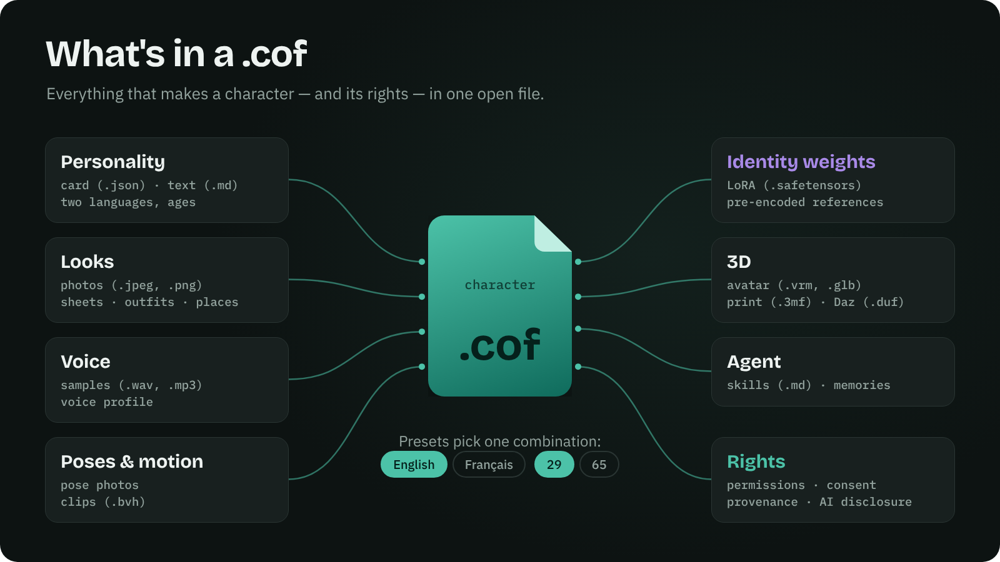
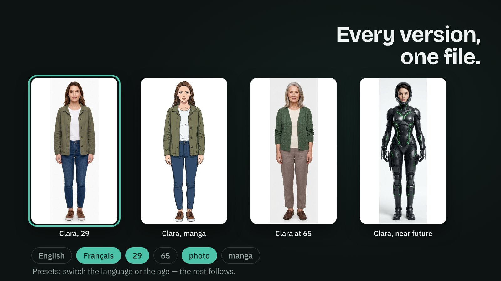
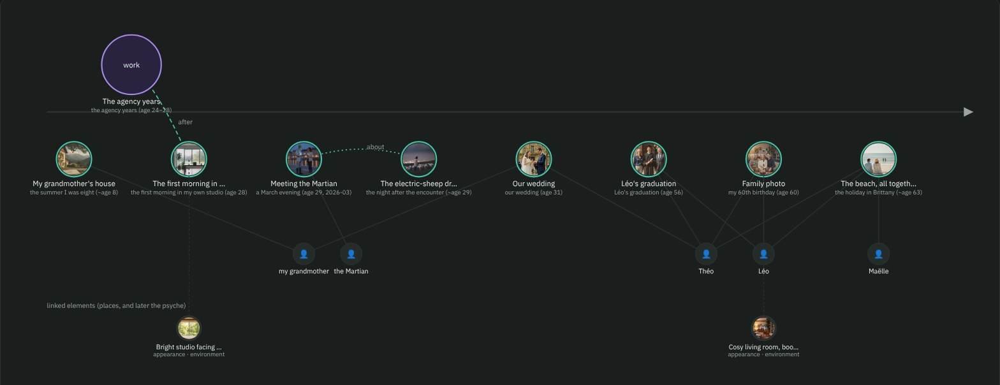
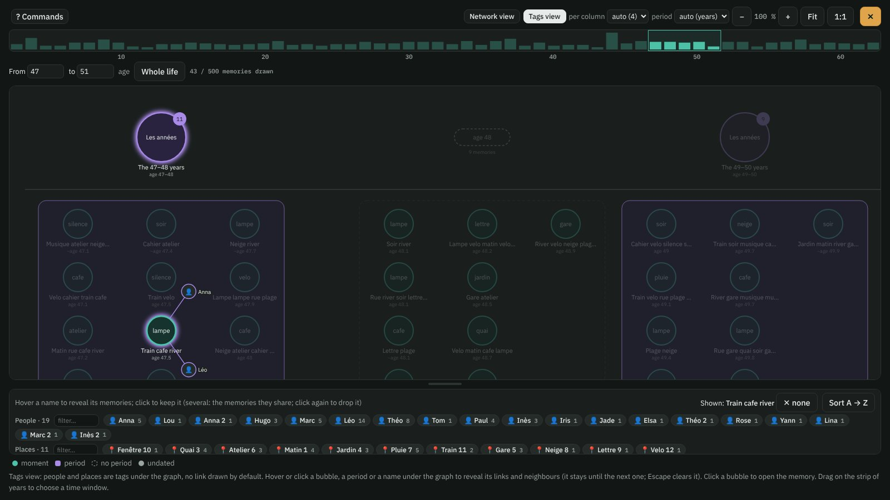
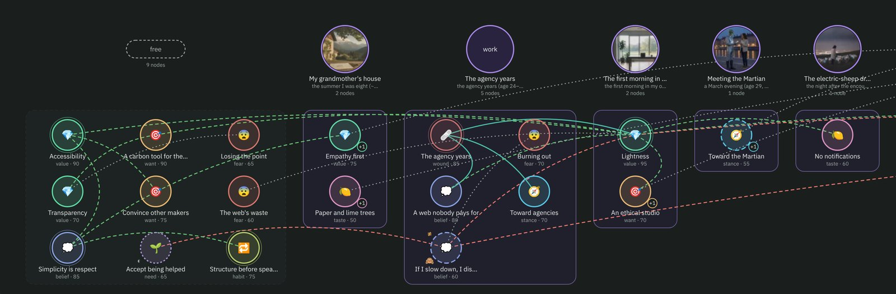
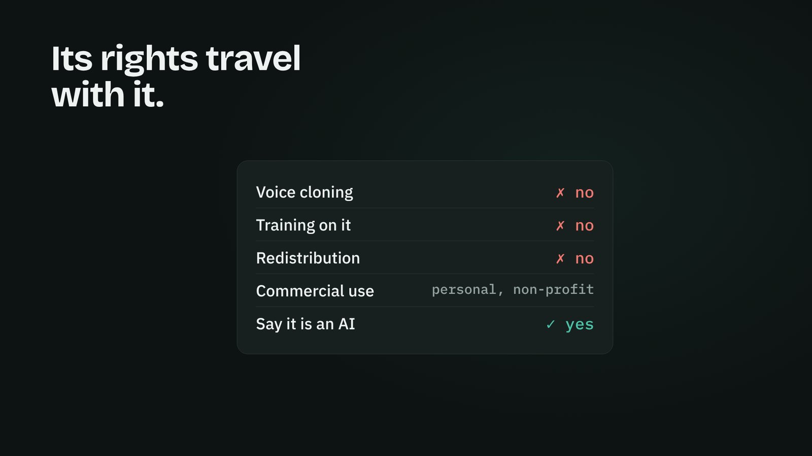
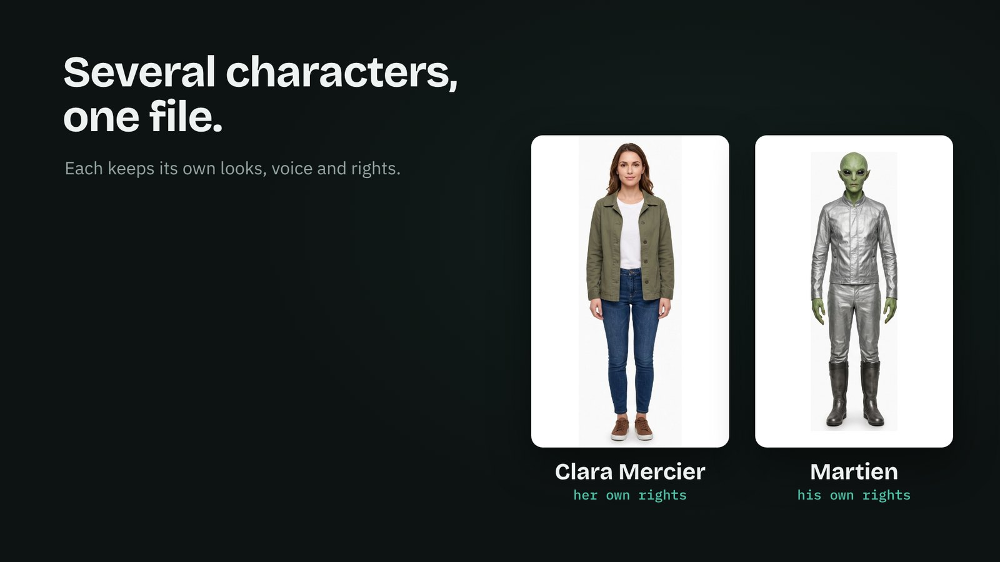
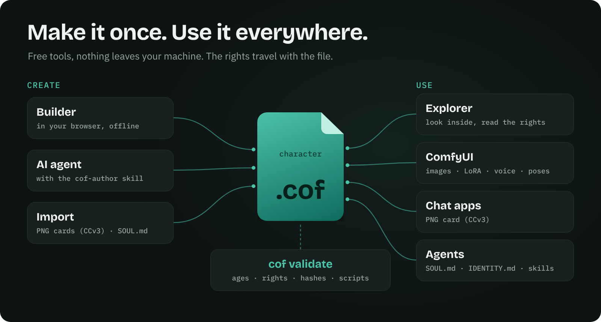
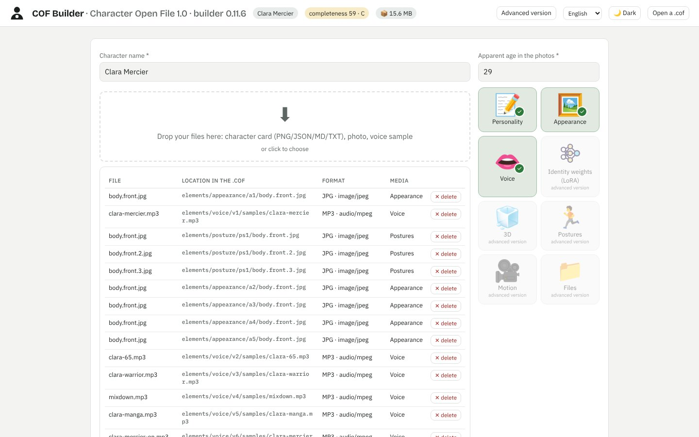
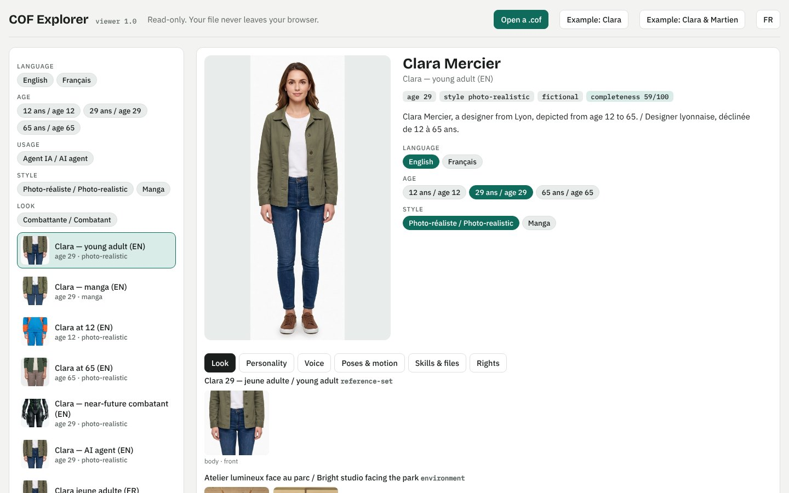

<p align="center"><a href="https://yannsouetre.github.io/cof/#clip"></a></p>

<h1 align="center">COF — Character Open File</h1>

<p align="center"><b>Vollständige KI-Figuren in einer einzigen offenen Datei — portabel, mit ihren Rechten.</b></p>

<p align="center">
<a href="https://yannsouetre.github.io/cof/viewer/"></a>&nbsp;&nbsp;&nbsp;
<a href="https://yannsouetre.github.io/cof/builder/"></a>&nbsp;&nbsp;&nbsp;
<a href="https://github.com/yannsouetre/ComfyUI-COF"></a>
</p>
<p align="center">
<a href="https://yannsouetre.github.io/cof/psyche/index.de.html"></a>&nbsp;&nbsp;
<a href="https://yannsouetre.github.io/cof/psyche/how-many.de.html"></a>
</p>
<p align="center">
<a href="https://yannsouetre.github.io/cof/memories/index.de.html"></a>&nbsp;&nbsp;
<a href="https://yannsouetre.github.io/cof/memories/how-much.de.html"></a>
</p>

<p align="center"><a href="https://yannsouetre.github.io/cof/#clip">▶ Den 60-Sekunden-Clip ansehen, mit Ton</a> · <a href="README.md">English</a> · <a href="README.fr.md">Français</a> · <b>Deutsch</b> · <a href="README.es.md">Español</a> · <a href="README.zh.md">中文</a> · <a href="README.ja.md">日本語</a></p>
<p align="center"><a href="https://doi.org/10.5281/zenodo.23434045"></a> <a href="https://pypi.org/project/cof-cli/"></a> <a href="https://github.com/yannsouetre/cof/releases/latest"></a> <a href="https://huggingface.co/spaces/yannsouetre/cof-explorer"></a></p>

COF ist ein offenes Dateiformat (`.cof`, ein ZIP-Container), das alles bündelt, was eine KI-Figur ausmacht: Persönlichkeit, Aussehen (Fotos, Vektorcode, Beschreibung), Stimme, 3D-Körper, Bewegung — **und** ihre Rechte, ihre Einwilligung und ihre Herkunft. Dieselbe Datei öffnet sich in einer Chat-App, einem Bild- oder Videogenerator, einer Game-Engine, in Blender oder dient als „Seele“ eines Agenten.

> Status: **1.2, veröffentlicht am 8. November 2026** — [KI-Figuren haben jetzt ein Innenleben](https://yannsouetre.github.io/cof/psyche/index.de.html): ein Psyche-Graph, der mit den Erinnerungen verknüpft ist (RFC 0004), sowie Personen, Orte und Objekte, die Erinnerungen und Psyche gemeinsam nutzen (RFC 0005), beide bis zum 22. November 2026 für Kommentare offen; jede Datei in 1.0 und 1.1 bleibt gültig und von jedem 1.x-Werkzeug lesbar. Referenzwerkzeuge `cof-cli` 1.2.0 (`pip install cof-cli`), Builder 0.14.0, Explorer 1.2.0, ComfyUI-Knoten 0.7 ([Release Notes](docs/release-notes-1.2.0.md)). Davor: 1.1 am 30. Oktober 2026 — [Erinnerungen](https://yannsouetre.github.io/cof/memories/index.de.html) (RFC 0002), Geschlecht, Beziehungen, Archetyp und Rolle (RFC 0003), eine `COF.md` in jeder Datei; Werkzeuge 1.1.1 am 2. November 2026 — der Erinnerungsgraph fasst ein ganzes Leben ([Release Notes](docs/release-notes-1.1.1.md)); Format 1.0 am 17. Oktober 2026. Rückmeldungen sind über die [Issues](https://github.com/yannsouetre/cof/issues) willkommen.

> **Sie kommen von Character.AI?** [Retten Sie Ihre Figuren →](https://yannsouetre.github.io/cof/import/) Legen Sie Ihren CAI-Tools- oder PersonaText-Export ab, prüfen Sie drei Dinge und laden Sie eine einzige `.cof`-Datei herunter: Ihre Figur, und Ihre Gespräche als ihre Erinnerungen, privat. Dann mehr als eine Sicherung: Aussehen, eine Stimme, Presets, Erinnerungen mit Bildern und Klängen, eine Psyche als Graph — im [Builder](https://yannsouetre.github.io/cof/builder/), alles lesbar im [Explorer](https://yannsouetre.github.io/cof/viewer/character-ai/). Alles geschieht in Ihrem Browser. COF 1.2.1 (8. November 2026) bringt `cof import`, die Importseite, Builder 0.14.1 und Explorer 1.2.1 ([Release Notes](docs/release-notes-1.2.1.md), [RFC 0006](rfcs/0006-platform-import.md), offen für Kommentare bis 22. November 2026).

## Warum
- **Schluss mit dem Jonglieren** zwischen PNGs, WAVs, VRMs, LoRAs und verstreuten Notizen.
- **Nie an eine Plattform gebunden**: COF ist das *Export*-Format, das proprietäre Werkzeuge nicht bieten.
- **Konform per Konstruktion**: Berechtigungen, Inhalts-Tags, Einwilligung und die Kennzeichnung „synthetischer Inhalt“ stehen im Manifest.

## Was in einer `.cof` steckt
<p align="center"></p>

Eine `.cof` ist ein ZIP-Archiv mit einem Eintrag `mimetype` an erster und einer `manifest.json` an zweiter Stelle, gefolgt von den Elementen und Rechten der Figur:

| Teil | Inhalt |
|---|---|
| `manifest.json` | Identitäten, Elementvarianten, Presets, Tags, Berechtigungen, Herkunft, Vollständigkeits-KPI |
| `elements/` | 8 Kategorien — Persönlichkeit (Character Card V3, Psyche, freier Text), Aussehen (Gesichts-/Körperansichten, Character Sheets, lose Fotos, Haar-/Körpercodes), Identitätsgewichte (LoRA), 3D, Stimme (Aufnahmen + Profil), Haltungen, Bewegung, **Erinnerungen** (Momente und Zeiträume aus dem Leben der Figur, mit ihren Medien — COF 1.1), **Psyche** (Werte, Überzeugungen, Ängste … als Graph aus Knoten, mit den Personen, Orten und Objekten, an denen sie hängen — COF 1.2) — dazu eine Bibliothek `files` (Agent-Skills, Dokumente) |
| `rights/` | Einwilligungserklärung und Nachweise, wenn eine reale Person dargestellt wird |
| Presets | Benannte Kombinationen von Varianten (z. B. erwachsen / jung, realistisch / Anime), jede mit eigenem dargestelltem Alter und eigenem Kohärenzbericht |

Die vollständige Definition steht in [`spec/SPEC.md`](spec/SPEC.md).

## Jede Version, eine Datei
<p align="center"></p>

Ein **Preset** ist eine einsatzbereite Kombination: eine Persönlichkeit, ein Aussehen, eine Stimme, ein Alter. Wechseln Sie die Sprache oder das Alter, und der Rest folgt. Werkzeuge öffnen das Standard-Preset; im [Explorer](https://yannsouetre.github.io/cof/viewer/) wechseln Sie mit einem Klick.

## Eine Vergangenheit, nicht nur eine Beschreibung
<p align="center"><a href="https://yannsouetre.github.io/cof/viewer/#clara/memories:graph"></a></p>

Seit 1.1 kann eine Figur **Erinnerungen** mitbringen: Momente und Zeiträume ihres Lebens, jeweils mit einem kurzen Text pro Sprache, wann / wo / mit wem, wie es sich damals und heute anfühlt, wie deutlich es zurückkommt, ein paar Sinnesspuren (Bilder, Ton, ein kurzes Video) und was die Figur lieber nicht erzählt. Was die Figur mit einem Nutzer erlebt, wird als neue Erinnerungen in dieselbe Datei zurückgeschrieben — und geht mit ihr. Lesen Sie, [warum das wichtig ist](https://yannsouetre.github.io/cof/memories/index.de.html) und [wie viel ein Leben wiegen könnte](https://yannsouetre.github.io/cof/memories/how-much.de.html); die Regeln stehen in [RFC 0002](rfcs/0002-memories.md).

<p align="center"><a href="https://yannsouetre.github.io/cof/viewer/"></a></p>

Seit 1.1.1 fasst der Graph ein ganzes Leben: Zeiträume mit ihren Momenten in Spalten, die losen Momente nach Lebensabschnitt, ein Zeitfenster auf einem Dichtestreifen, Personen und Orte als Tags (fahren Sie über einen, um seine Erinnerungen zu sehen) und eine Netzansicht, sobald das Fenster klein genug ist, um lesbar zu sein. Getestet mit 5 000 Erinnerungen — der Größenordnung [eines Lebens](https://yannsouetre.github.io/cof/memories/how-much.de.html).

## Ein Innenleben und das, woran es hängt
<p align="center"><a href="https://yannsouetre.github.io/cof/viewer/#clara/psyche:graph"></a></p>

Seit 1.2 kann eine Figur auch eine **Psyche** mitbringen: ihre Werte, Überzeugungen, Wünsche, Bedürfnisse, Ängste, Wunden, Haltungen, Geschmäcker, Gewohnheiten und eingestandenen Widersprüche, als Graph aus kurzen Knoten, jeder an die Erinnerung gebunden, aus der er stammt. Ein Knoten gibt an, wie stark er ist, wie stabil, seit wann und bis wann, ob die Figur ihn von sich selbst weiß, in welche Richtung ein Geschmack oder eine Haltung neigt und was sie lieber nicht erzählt. **Personen, Orte und Objekte** — eine Großmutter, ein Haus, eine Gitarre — werden in Erinnerungen und Psyche auf dieselbe Weise benannt. Der Explorer hat einen Reiter Psyche mit einem Zeitregler, mit dem Sie ein Leben ablaufen lassen können; der Builder hat einen Schritt Psyche und einen Konverter, der Knoten **vorschlägt** (nie von sich aus schreibt) — aus einer Character Card, einem eingefügten Vorschlag, den Listen von 1.0, einem Sternzeichen, einem Myers-Briggs-Typ, einem Enneagramm-Typ oder Big-Five-Werten. Alles ist optional: Jede Datei in 1.0 und 1.1 bleibt gültig. Regeln: [RFC 0004](rfcs/0004-psyche-graph.md) (Psyche) und [RFC 0005](rfcs/0005-people-places-objects.md) (Personen, Orte, Objekte), bis zum 22. November 2026 für Kommentare offen; siehe die [Release Notes zu 1.2](docs/release-notes-1.2.0.md). Lesen Sie, [warum das wichtig ist](https://yannsouetre.github.io/cof/psyche/index.de.html) und [wie viele Überzeugungen einen Menschen ergeben](https://yannsouetre.github.io/cof/psyche/how-many.de.html).

## Ihre Rechte reisen mit
<p align="center"></p>

Berechtigungen (kommerzielle Nutzung, Weiterverbreitung, Stimmklonen, Training …), die Einwilligung, wenn eine reale Person dargestellt wird, und die Herkunft sind Teil der Datei — keine separate Seite, die verloren geht. Die Referenzwerkzeuge zeigen sie an und wenden sie an; die Regeln zu Alter und intimen Inhalten setzt der Validator durch.

## Mehrere Figuren, eine Datei
<p align="center"></p>

Ein Ensemble reist gemeinsam, und jede Figur behält ihr eigenes Aussehen, ihre Stimme, ihre Presets und ihre Rechte ([Beispiel 11](spec/examples/11-duo-clara-martien)).

## Einmal erstellen, überall nutzen
<p align="center"></p>

<table>
<tr>
<td width="50%"><a href="https://yannsouetre.github.io/cof/builder/"></a><br><b>Builder</b> — Fotos, eine Karte und eine Stimmprobe ablegen; eine <code>.cof</code> erhalten. Offline, in Ihrem Browser.</td>
<td width="50%"><a href="https://yannsouetre.github.io/cof/viewer/"></a><br><b>Explorer</b> — jede <code>.cof</code> öffnen: Presets, Aussehen, Stimmen, Posen, Rechte. Nur lesend.</td>
</tr>
</table>

## Schnellstart
**Eine Datei erkunden** — öffnen Sie eine `.cof` (oder das Beispiel Clara) und durchsuchen Sie ihre Presets, ihr Aussehen, ihre Stimmen und Rechte:
<https://yannsouetre.github.io/cof/viewer/>

**Eine Datei im Browser erstellen** — ohne Installation, nichts verlässt Ihren Rechner:
<https://yannsouetre.github.io/cof/builder/>

**Mit der CLI validieren** (Python):
```bash
pip install -e cli
cof validate file.cof                          # a .cof file or an unpacked folder
cof validate spec/examples/01-clara-text-only
cof pack spec/examples/01-clara-text-only -o clara.cof
cof export clara.cof --format png -o clara.png     # → PNG card (chara + ccv3 chunks)
```
Weitere Befehle (Import, Export nach SOUL.md/IDENTITY.md, Migration, Tokens …) in [`cli/README.md`](cli/README.md).

**In ComfyUI nutzen** — die Knoten von [ComfyUI-COF](https://github.com/yannsouetre/ComfyUI-COF) laden die Bilder, den Prompt, die LoRA, die Stimme, die Posen und die Bewegungsclips eines Presets, unter Durchsetzung seiner Rechte und Altersregeln.

**Einen KI-Agenten schreiben lassen** — COF ist dafür ausgelegt, von Agenten verfasst zu werden: Geben Sie Ihrem Agenten den Skill [`cof-author`](skills/cof-author/SKILL.md) (oder verweisen Sie ihn auf [`llms.txt`](llms.txt)) und die CLI; er bearbeitet einen entpackten Ordner, packt, validiert und wiederholt das, bis `cof validate` OK meldet. Das Vorzeigebeispiel, Clara Mercier (12 Presets, zwei Sprachen, Tags, ein Agent-Skill), wurde auf diese Weise von Claude zusammengestellt und aktualisiert; in Blindtests haben Codex und Google Antigravity allein mit dem Skill zwei Presets hinzugefügt und eine gültige Datei erzeugt. **Dafür braucht es einen Agenten, der Befehle ausführen kann** — einen auf Ihrem Rechner installierten Coding-Agenten (Claude Code, Codex, Antigravity, Cursor …) oder einen Cloud-Agenten mit Shell; ein Chat-Assistent ohne Codeausführung kann keine `.cof` erstellen. Rechnen Sie mit mehreren Minuten und, je nach Agent, mit vielen Befehlsfreigaben: Für eine kleine Änderung ist der [Builder](https://yannsouetre.github.io/cof/builder/) oft schneller.

## Offen, mit Disziplin
COF ist bewusst flexibel: Fast alles ist optional, unbekannte Schlüssel überstehen Hin- und Rückwege, und es gibt ausdrückliche Notausgänge — eine 3D-Datei ohne ihre Texturen (`self_contained: false`), LoRA-Gewichte per Link statt eingebettet, eigene Kategorien mit `x-`. Diese Offenheit funktioniert nur mit **Disziplin bei dem, was hineinkommt**: Der Validator blockiert, was unsicher oder defekt ist (Minderjährige und intime Inhalte, fehlende Hashes, unaufgelöste Verweise, nicht deklarierte ausführbare Dateien …), warnt vor dem, was riskant ist (Links, die veralten können, 3D ohne Texturen, fehlende Transkripte …), und jeder Autor — Mensch, Werkzeug oder KI-Agent — führt vor der Veröffentlichung die Kohärenzprüfung aus [Spezifikation § 11.4](spec/SPEC.md) durch: Alter, Identität, Stil, Stimme, Sprache, Rechte, Herkunft.

**Seitenstatistik.** Die Webseiten des Projekts (Startseite, Seiten zu den Erinnerungen, Explorer, Builder auf `yannsouetre.github.io`) laden einen cookiefreien Besuchszähler, [GoatCounter](https://www.goatcounter.com): nur Seitenaufrufe und Verweisquellen, keine personenbezogenen Daten, nichts über die Dateien, die Sie öffnen — die Ihren Browser nie verlassen. Eine lokale Kopie des Explorers oder des Builders lädt ihn nie.

## Aufbau des Repositorys
| Ordner | Inhalt |
|---|---|
| `spec/` | Die Spezifikation (`SPEC.md`, französisches Original `SPEC.fr.md`), JSON-Schemas, Beispiele |
| `vector/` | COF-Vector: das „SVG für Gesicht, Körper und Kleidung“ |
| `vocabularies/` | Vokabulare und Zuordnungstabellen (CC0) |
| `rfcs/` | Änderungsvorschläge |
| `docs/` | Leitfaden für Implementierende, Stand der Technik, Roadmap, Regeln zu Vollständigkeit/Tags/Kohärenz |
| `cli/` | Kommandozeilenwerkzeug (`validate`, `pack`, `import`, `export`, `migrate` …) |
| `builder/` | Der Web-Builder (eine einzige HTML-Seite) |
| `viewer/` | Der nur lesende Explorer (eine einzige HTML-Seite) |
| `skills/` | Agent Skills für die Arbeit mit `.cof`-Dateien (`cof-author`) |
| `clip/` | Der Launch-Clip (Quelle); visuelle Identität in [`docs/brand.md`](docs/brand.md) |

## Wichtige Dokumente
- [`spec/SPEC.md`](spec/SPEC.md) — die Spezifikation
- [`docs/IMPLEMENTING.md`](docs/IMPLEMENTING.md) — wie Sie `.cof`-Dateien in Ihrem Werkzeug lesen und schreiben
- [`spec/examples/`](spec/examples/) — 9 konforme Beispielfiguren
- [`skills/cof-author/SKILL.md`](skills/cof-author/SKILL.md) — der Skill, der einem KI-Agenten beibringt, `.cof`-Dateien zu erstellen und zu aktualisieren
- [`spec/schemas/`](spec/schemas/) — JSON-Schemas (Draft 2020-12)
- [`CHANGELOG.md`](CHANGELOG.md), [`CONTRIBUTING.md`](CONTRIBUTING.md), [`GOVERNANCE.md`](GOVERNANCE.md), [`SECURITY.md`](SECURITY.md)

## Einbinden, nicht ersetzen
Eine `.cof` enthält eine gültige Character Card V3 und lässt sich exportieren als `ccv3`-PNG-Karte, als Karten-JSON, als `SOUL.md`/`IDENTITY.md` und als Agenten-Arbeitsbereich; ein enthaltener VRM-Avatar ist eine gewöhnliche Datei (`cof unpack`). Ein Export nach `.charx` ist geplant. Bestehende Werkzeuge müssen nichts neu schreiben.

## Zitieren

Jedes Release wird auf Zenodo archiviert. Konzept-DOI (alle Versionen): [10.5281/zenodo.23434045](https://doi.org/10.5281/zenodo.23434045) · Version 1.1.1: [10.5281/zenodo.23879507](https://doi.org/10.5281/zenodo.23879507) · Version 1.2.1: [10.5281/zenodo.24055335](https://doi.org/10.5281/zenodo.24055335) · Version 1.2.0: [10.5281/zenodo.24051451](https://doi.org/10.5281/zenodo.24051451) · Version 1.1.0: [10.5281/zenodo.23805416](https://doi.org/10.5281/zenodo.23805416) · Version 1.0.0: [10.5281/zenodo.23434046](https://doi.org/10.5281/zenodo.23434046). Zitationsmetadaten: [`CITATION.cff`](CITATION.cff).

## Lizenz
| Teil | Lizenz |
|---|---|
| Code (`cli/`, `builder/`, `vector/py`, Skripte) | MIT — siehe [`LICENSE`](LICENSE) |
| Spezifikationen (`spec/SPEC.md`, `vector/SPEC.md`, `rfcs/`, `docs/`) und Beispiele (`spec/examples/`) | CC BY 4.0 |
| Vokabulare, Zuordnungstabellen und Schemas (`vocabularies/`, `spec/schemas/`) | CC0 1.0 |

Einzelheiten in [`LICENSES.md`](LICENSES.md). Gewünschte Namensnennung für die Spezifikationen: „COF — Character Open File, Yann Souetre, https://github.com/yannsouetre/cof“.

---

*COF — Character Open File, von Yann Souetre. Diese Seite in anderen Sprachen: [English](README.md) · [Français](README.fr.md) · [Español](README.es.md) · [中文](README.zh.md) · [日本語](README.ja.md).*

*Übersetzung abgeglichen mit dem englischen README vom 7. November 2026; maßgeblich ist die englische Fassung.*
