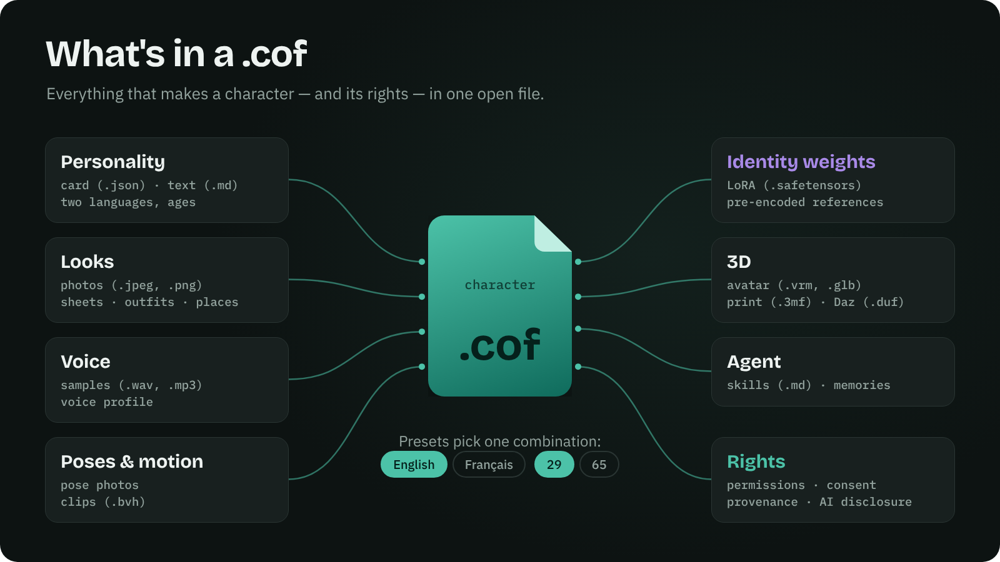
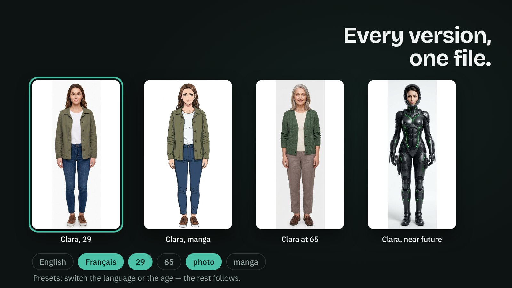
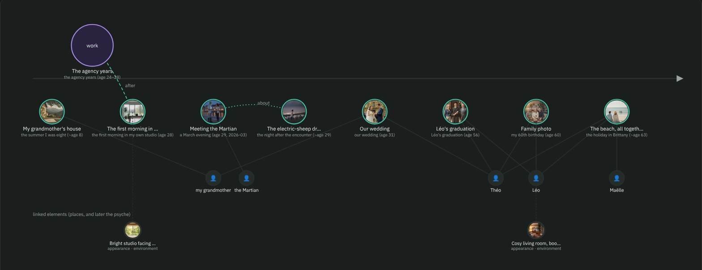
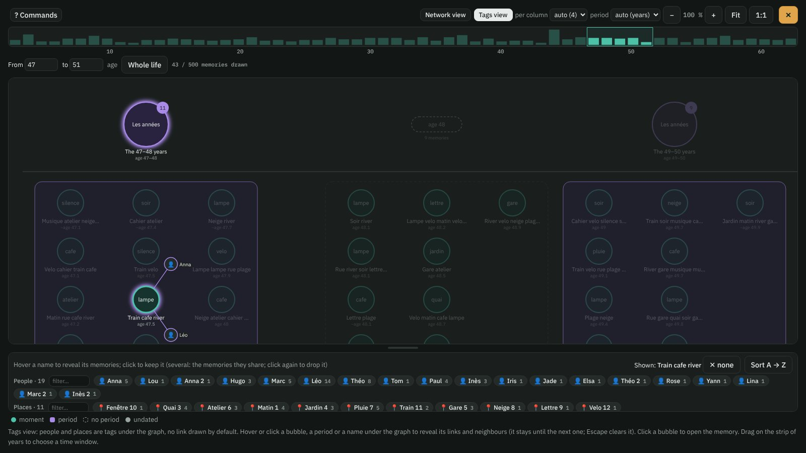
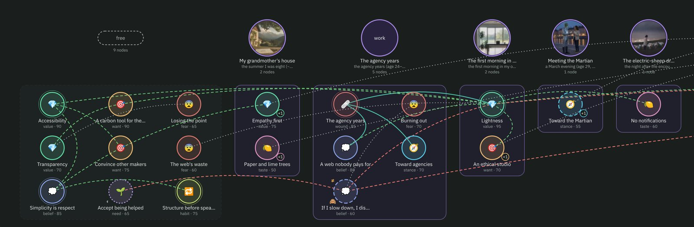
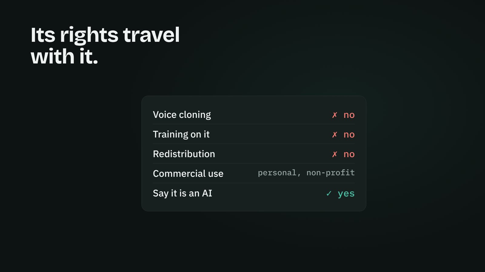
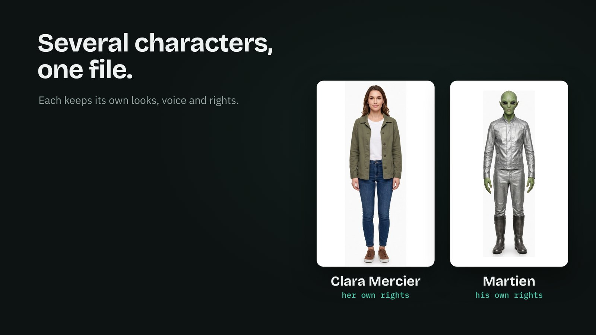
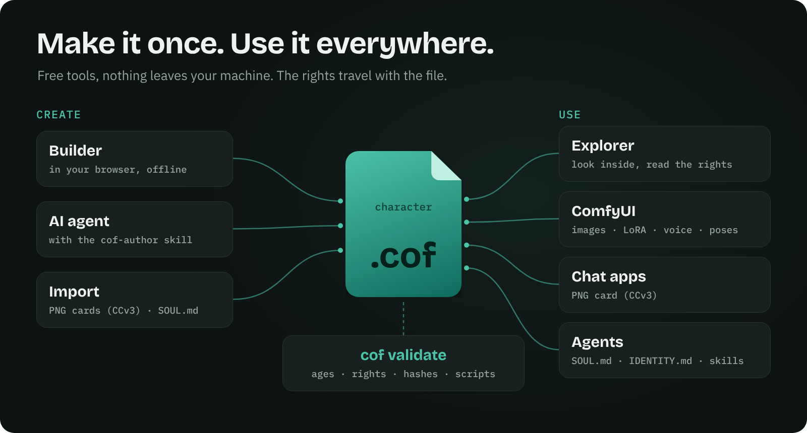
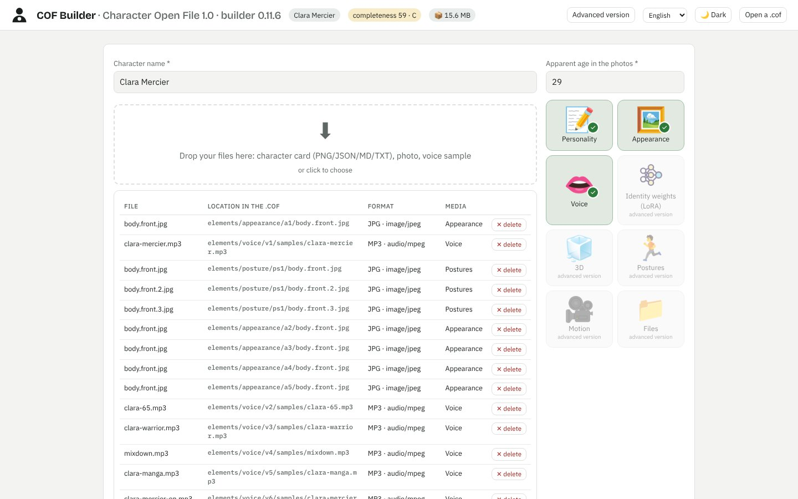
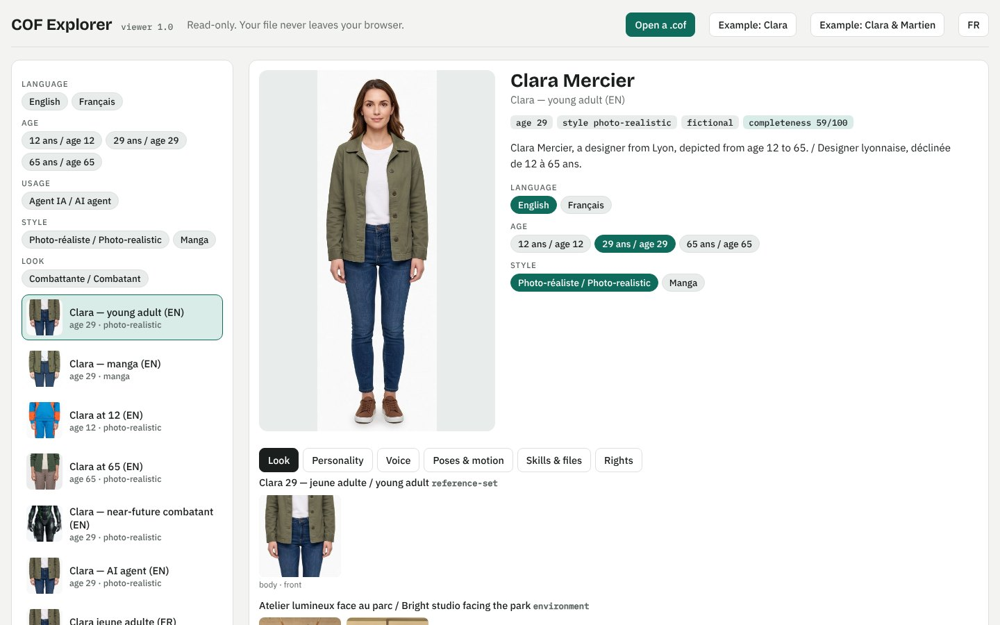

<p align="center"><a href="https://yannsouetre.github.io/cof/#clip"></a></p>

<h1 align="center">COF — Character Open File</h1>

<p align="center"><b>Personajes de IA completos en un solo archivo abierto — portátiles, con sus derechos.</b></p>

<p align="center">
<a href="https://yannsouetre.github.io/cof/viewer/"></a>&nbsp;&nbsp;&nbsp;
<a href="https://yannsouetre.github.io/cof/builder/"></a>&nbsp;&nbsp;&nbsp;
<a href="https://github.com/yannsouetre/ComfyUI-COF"></a>
</p>
<p align="center">
<a href="https://yannsouetre.github.io/cof/psyche/index.es.html"></a>&nbsp;&nbsp;
<a href="https://yannsouetre.github.io/cof/psyche/how-many.es.html"></a>
</p>
<p align="center">
<a href="https://yannsouetre.github.io/cof/memories/index.es.html"></a>&nbsp;&nbsp;
<a href="https://yannsouetre.github.io/cof/memories/how-much.es.html"></a>
</p>

<p align="center"><a href="https://yannsouetre.github.io/cof/#clip">▶ Ver el clip de 60 segundos, con sonido</a> · <a href="README.md">English</a> · <a href="README.fr.md">Français</a> · <a href="README.de.md">Deutsch</a> · <b>Español</b> · <a href="README.zh.md">中文</a> · <a href="README.ja.md">日本語</a></p>
<p align="center"><a href="https://doi.org/10.5281/zenodo.23434045"></a> <a href="https://pypi.org/project/cof-cli/"></a> <a href="https://github.com/yannsouetre/cof/releases/latest"></a> <a href="https://huggingface.co/spaces/yannsouetre/cof-explorer"></a></p>

COF es un formato de archivo abierto (`.cof`, un contenedor ZIP) que reúne todo lo que define a un personaje de IA: personalidad, aspecto (fotos, código vectorial, descripción), voz, cuerpo 3D, movimiento — **y** sus derechos, su consentimiento y su procedencia. El mismo archivo se abre en una aplicación de chat, un generador de imágenes o de vídeo, un motor de juego, Blender, o sirve de «alma» a un agente.

> Estado: **1.2, publicada el 8 de noviembre de 2026** — [los personajes de IA ya tienen vida interior](https://yannsouetre.github.io/cof/psyche/index.es.html): un grafo de psique ligado a los recuerdos (RFC 0004) y personas, lugares y objetos compartidos por los recuerdos y la psique (RFC 0005), ambas abiertas a comentarios hasta el 22 de noviembre de 2026; todo archivo 1.0 y 1.1 sigue siendo válido y legible por todas las herramientas 1.x. Herramientas de referencia: `cof-cli` 1.2.0 (`pip install cof-cli`), builder 0.14.0, explorador 1.2.0, nodos de ComfyUI 0.7 ([notas de la versión](docs/release-notes-1.2.0.md)). Antes: 1.1 el 30 de octubre de 2026 — [los recuerdos](https://yannsouetre.github.io/cof/memories/index.es.html) (RFC 0002), género, relaciones, arquetipo y rol (RFC 0003), un `COF.md` en cada archivo; herramientas 1.1.1 el 2 de noviembre de 2026 — el grafo de recuerdos abarca una vida entera ([notas de la versión](docs/release-notes-1.1.1.md)); formato 1.0 el 17 de octubre de 2026. Los comentarios son bienvenidos a través de los [issues](https://github.com/yannsouetre/cof/issues).

> **¿Viene de Character.AI?** [Salve sus personajes →](https://yannsouetre.github.io/cof/import/) Suelte su exportación de CAI Tools o PersonaText, compruebe tres cosas y descargue un solo archivo `.cof`: su personaje, y sus conversaciones convertidas en sus recuerdos, en privado. Luego vaya más allá de una copia: apariencias, una voz, presets, recuerdos con imágenes y sonidos, una psique en grafo — en el [builder](https://yannsouetre.github.io/cof/builder/), todo legible en el [explorador](https://yannsouetre.github.io/cof/viewer/character-ai/). Todo ocurre en su navegador. COF 1.2.1 (8 de noviembre de 2026) añade `cof import`, la página de importación, el builder 0.14.1 y el explorador 1.2.1 ([notas de la versión](docs/release-notes-1.2.1.md), [RFC 0006](rfcs/0006-platform-import.md), abierta a comentarios hasta el 22 de noviembre de 2026).

## Por qué
- **Se acabó hacer malabares** con PNG, WAV, VRM, LoRA y notas dispersas.
- **Nunca atrapado en una plataforma**: COF es el formato de *exportación* que las herramientas propietarias no ofrecen.
- **Conforme desde el diseño**: permisos, etiquetas de contenido, consentimiento y marcado de «contenido sintético» viven en el manifiesto.

## Qué contiene un `.cof`
<p align="center"></p>

Un `.cof` es un archivo ZIP con una entrada `mimetype` en primer lugar y un `manifest.json` en segundo, seguidos de los elementos del personaje y sus derechos:

| Parte | Contenido |
|---|---|
| `manifest.json` | Identidades, variantes de elementos, presets, etiquetas, permisos, procedencia, KPI de completitud |
| `elements/` | 8 categorías — personalidad (Character Card V3, psique, texto libre), aspecto (vistas de rostro/cuerpo, hojas de personaje, fotos sueltas, códigos de cabello/cuerpo), pesos de identidad (LoRA), 3D, voz (muestras + perfil), posturas, movimiento, **recuerdos** (momentos y períodos de la vida del personaje, con sus medios — COF 1.1), **psique** (valores, creencias, miedos… como un grafo de nodos, con las personas, los lugares y los objetos a los que se aferran — COF 1.2) — más una biblioteca `files` (skills de agente, documentos) |
| `rights/` | Registro de consentimiento y pruebas cuando se representa a una persona real |
| Presets | Combinaciones de variantes con nombre (p. ej., adulta / joven, realista / anime), cada una con su propia edad representada y su informe de coherencia |

Consulta [`spec/SPEC.md`](spec/SPEC.md) para la definición completa.

## Todas las versiones, un solo archivo
<p align="center"></p>

Un **preset** es una combinación lista para usar: una personalidad, un aspecto, una voz, una edad. Cambia el idioma o la edad, y el resto sigue. Las herramientas abren el preset por defecto; el [explorador](https://yannsouetre.github.io/cof/viewer/) permite cambiarlo con un clic.

## Un pasado, no solo una descripción
<p align="center"><a href="https://yannsouetre.github.io/cof/viewer/#clara/memories:graph"></a></p>

Desde la 1.1, un personaje puede llevar **recuerdos**: momentos y períodos de su vida, cada uno con un texto breve por idioma, cuándo / dónde / con quién, cómo se sintió entonces y cómo se siente ahora, con qué claridad vuelve, algunas huellas sensoriales (imágenes, sonido, un vídeo corto) y lo que el personaje prefiere no contar. Lo que el personaje vive con un usuario se escribe en el mismo archivo como nuevos recuerdos — y se va con él. Lee [por qué importa](https://yannsouetre.github.io/cof/memories/index.es.html) y [cuánto podría pesar una vida](https://yannsouetre.github.io/cof/memories/how-much.es.html); las reglas están en la [RFC 0002](rfcs/0002-memories.md).

<p align="center"><a href="https://yannsouetre.github.io/cof/viewer/"></a></p>

Desde la 1.1.1, el grafo abarca una vida entera: los períodos con sus momentos en columnas, los momentos sueltos por etapa de la vida, una ventana temporal sobre una franja de densidad, las personas y los lugares como etiquetas (pasa el cursor sobre una para ver sus recuerdos) y una vista de red cuando la ventana es lo bastante pequeña para leerse. Probado con 5000 recuerdos — el orden de magnitud de [una vida](https://yannsouetre.github.io/cof/memories/how-much.es.html).

## Una vida interior, y aquello a lo que se aferra
<p align="center"><a href="https://yannsouetre.github.io/cof/viewer/#clara/psyche:graph"></a></p>

Desde la 1.2, un personaje también puede llevar una **psique**: sus valores, creencias, deseos, necesidades, miedos, heridas, posturas, gustos, hábitos y contradicciones asumidas, como un grafo de nodos breves, cada uno ligado al recuerdo del que procede. Un nodo indica su fuerza, su estabilidad, desde cuándo y hasta cuándo, si el personaje lo sabe de sí mismo, hacia qué lado se inclina un gusto o una postura, y lo que prefiere no contar. Las **personas, los lugares y los objetos** — una abuela, una casa, una guitarra — se nombran del mismo modo en los recuerdos y en la psique. El explorador tiene una pestaña Psique con un cursor temporal que puedes reproducir a lo largo de una vida; el builder tiene un paso Psique y un convertidor que **propone** nodos (nunca los escribe por su cuenta) a partir de una tarjeta de personaje, una propuesta pegada, las listas 1.0, un signo del zodiaco, un tipo Myers-Briggs, un tipo del eneagrama o puntuaciones Big Five. Todo es opcional: todo archivo 1.0 y 1.1 sigue siendo válido. Reglas: [RFC 0004](rfcs/0004-psyche-graph.md) (psique) y [RFC 0005](rfcs/0005-people-places-objects.md) (personas, lugares, objetos), abiertas a comentarios hasta el 22 de noviembre de 2026; consulta las [notas de la versión 1.2](docs/release-notes-1.2.0.md). Lee [por qué importa](https://yannsouetre.github.io/cof/psyche/index.es.html) y [cuántas convicciones hacen a una persona](https://yannsouetre.github.io/cof/psyche/how-many.es.html).

## Sus derechos viajan con él
<p align="center"></p>

Los permisos (uso comercial, redistribución, clonación de voz, entrenamiento…), el consentimiento cuando se representa a una persona real y la procedencia forman parte del archivo — no son una página aparte que se pierde. Las herramientas de referencia los muestran y los aplican; el validador hace cumplir las reglas sobre la edad y el contenido íntimo.

## Varios personajes, un solo archivo
<p align="center"></p>

Un reparto viaja junto, y cada personaje conserva su propio aspecto, su voz, sus presets y sus derechos ([ejemplo 11](spec/examples/11-duo-clara-martien)).

## Créalo una vez, úsalo en todas partes
<p align="center"></p>

<table>
<tr>
<td width="50%"><a href="https://yannsouetre.github.io/cof/builder/"></a><br><b>Builder</b> — suelta fotos, una tarjeta y una muestra de voz; obtienes un <code>.cof</code>. Sin conexión, en tu navegador.</td>
<td width="50%"><a href="https://yannsouetre.github.io/cof/viewer/"></a><br><b>Explorador</b> — abre cualquier <code>.cof</code>: presets, aspectos, voces, poses, derechos. Solo lectura.</td>
</tr>
</table>

## Inicio rápido
**Explorar un archivo** — abre un `.cof` (o el ejemplo de Clara) y recorre sus presets, aspectos, voces y derechos:
<https://yannsouetre.github.io/cof/viewer/>

**Crear un archivo en el navegador** — sin instalación, nada sale de tu equipo:
<https://yannsouetre.github.io/cof/builder/>

**Validar con la CLI** (Python):
```bash
pip install -e cli
cof validate file.cof                          # a .cof file or an unpacked folder
cof validate spec/examples/01-clara-text-only
cof pack spec/examples/01-clara-text-only -o clara.cof
cof export clara.cof --format png -o clara.png     # → PNG card (chara + ccv3 chunks)
```
Más comandos (importación, exportación a SOUL.md/IDENTITY.md, migración, tokens…) en [`cli/README.md`](cli/README.md).

**Usarlo en ComfyUI** — los nodos [ComfyUI-COF](https://github.com/yannsouetre/ComfyUI-COF) cargan las imágenes, el prompt, el LoRA, la voz, las poses y los clips de movimiento de un preset, haciendo cumplir sus derechos y sus reglas de edad.

**Dejar que un agente de IA lo escriba** — COF está diseñado para que lo redacten agentes: dale al tuyo la skill [`cof-author`](skills/cof-author/SKILL.md) (o remítelo a [`llms.txt`](llms.txt)) y la CLI; edita una carpeta desempaquetada, empaqueta, valida y repite hasta que `cof validate` dice OK. El ejemplo insignia, Clara Mercier (12 presets, dos idiomas, etiquetas, una skill de agente), fue ensamblado y actualizado así por Claude; en pruebas a ciegas, Codex y Google Antigravity añadieron dos presets solo con la skill y produjeron un archivo válido. **Esto requiere un agente capaz de ejecutar comandos** — un agente de programación instalado en tu ordenador (Claude Code, Codex, Antigravity, Cursor…) o un agente en la nube con una terminal; un asistente de chat sin ejecución de código no puede crear un `.cof`. Cuenta con varios minutos y, según el agente, muchas aprobaciones de comandos: para un cambio pequeño, el [builder](https://yannsouetre.github.io/cof/builder/) suele ser más rápido.

## Abierto, con disciplina
COF es flexible a propósito: casi todo es opcional, las claves desconocidas sobreviven a los viajes de ida y vuelta, y hay vías de escape explícitas — un archivo 3D sin sus texturas (`self_contained: false`), pesos LoRA por enlace en lugar de incrustados, categorías `x-` personalizadas. Esa apertura solo funciona con **disciplina en lo que entra**: el validador bloquea lo que es inseguro o está roto (menores y contenido íntimo, hashes ausentes, referencias sin resolver, ejecutables no declarados…), advierte de lo que es arriesgado (enlaces que pueden romperse, 3D sin texturas, transcripciones ausentes…), y todo autor — humano, herramienta o agente de IA — realiza la revisión de coherencia de la [spec § 11.4](spec/SPEC.md) antes de publicar: edades, identidad, estilo, voz, idioma, derechos, procedencia.

**Estadísticas del sitio.** Las páginas web del proyecto (inicio, páginas de recuerdos, explorador, builder, página de importación de Character.AI en `yannsouetre.github.io`) cargan un contador de visitas sin cookies, [GoatCounter](https://www.goatcounter.com): solo páginas vistas y sitios de procedencia, ningún dato personal, nada sobre los archivos que abres — que nunca salen de tu navegador. Una copia local del explorador o del builder nunca lo carga.

## Estructura del repositorio
| Carpeta | Contenido |
|---|---|
| `spec/` | La especificación (`SPEC.md`, original en francés `SPEC.fr.md`), JSON Schemas, ejemplos |
| `vector/` | COF-Vector: el «SVG del rostro, el cuerpo y la ropa» |
| `vocabularies/` | Vocabularios y tablas de correspondencia (CC0) |
| `rfcs/` | Propuestas de cambio |
| `docs/` | Guía para implementadores, estado del arte, hoja de ruta, reglas de completitud/etiquetas/coherencia |
| `cli/` | Herramienta de línea de comandos (`validate`, `pack`, `import`, `export`, `migrate`…) |
| `builder/` | El builder web (una sola página HTML) |
| `viewer/` | El explorador de solo lectura (una sola página HTML) |
| `skills/` | Agent Skills para trabajar con archivos `.cof` (`cof-author`) |
| `clip/` | El clip de lanzamiento (fuente); identidad visual en [`docs/brand.md`](docs/brand.md) |

## Documentos clave
- [`spec/SPEC.md`](spec/SPEC.md) — la especificación
- [`docs/IMPLEMENTING.md`](docs/IMPLEMENTING.md) — cómo leer y escribir archivos `.cof` en tu herramienta
- [`spec/examples/`](spec/examples/) — 9 personajes de ejemplo conformes
- [`skills/cof-author/SKILL.md`](skills/cof-author/SKILL.md) — la skill que enseña a un agente de IA a crear y actualizar archivos `.cof`
- [`spec/schemas/`](spec/schemas/) — JSON Schemas (draft 2020-12)
- [`CHANGELOG.md`](CHANGELOG.md), [`CONTRIBUTING.md`](CONTRIBUTING.md), [`GOVERNANCE.md`](GOVERNANCE.md), [`SECURITY.md`](SECURITY.md)

## Integrar, no sustituir
Un `.cof` contiene una Character Card V3 válida y se exporta a una tarjeta PNG `ccv3`, un JSON de tarjeta, `SOUL.md`/`IDENTITY.md` y un espacio de trabajo de agente; un avatar VRM incluido es un archivo normal (`cof unpack`). La exportación a `.charx` está prevista. Las herramientas existentes no tienen nada que reescribir.

## Citar

Cada versión se archiva en Zenodo. DOI de concepto (todas las versiones): [10.5281/zenodo.23434045](https://doi.org/10.5281/zenodo.23434045) · versión 1.1.1: [10.5281/zenodo.23879507](https://doi.org/10.5281/zenodo.23879507) · versión 1.2.1: [10.5281/zenodo.24055335](https://doi.org/10.5281/zenodo.24055335) · versión 1.2.0: [10.5281/zenodo.24051451](https://doi.org/10.5281/zenodo.24051451) · versión 1.1.0: [10.5281/zenodo.23805416](https://doi.org/10.5281/zenodo.23805416) · versión 1.0.0: [10.5281/zenodo.23434046](https://doi.org/10.5281/zenodo.23434046). Metadatos de citación: [`CITATION.cff`](CITATION.cff).

## Licencia
| Parte | Licencia |
|---|---|
| Código (`cli/`, `builder/`, `vector/py`, scripts) | MIT — ver [`LICENSE`](LICENSE) |
| Especificaciones (`spec/SPEC.md`, `vector/SPEC.md`, `rfcs/`, `docs/`) y ejemplos (`spec/examples/`) | CC BY 4.0 |
| Vocabularios, tablas de correspondencia y esquemas (`vocabularies/`, `spec/schemas/`) | CC0 1.0 |

Detalles en [`LICENSES.md`](LICENSES.md). Atribución solicitada para las especificaciones: "COF — Character Open File, Yann Souetre, https://github.com/yannsouetre/cof".

---

*COF — Character Open File, de Yann Souetre. Esta página en otros idiomas: [English](README.md) · [Français](README.fr.md) · [Deutsch](README.de.md) · [中文](README.zh.md) · [日本語](README.ja.md).*

*Traducción cotejada con el README en inglés del 7 de noviembre de 2026; la versión inglesa es la de referencia.*
