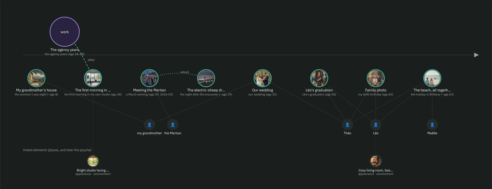

<h1 align="center">COF — Character Open File</h1>

<b>Des personnages IA complets dans un seul fichier ouvert — portables, avec leurs droits.</b>

&nbsp;&nbsp;&nbsp;
&nbsp;&nbsp;&nbsp;

&nbsp;&nbsp;

<a href="https://yannsouetre.github.io/cof/#clip">▶ Voir le clip de 60 secondes, avec le son</a> · <a href="README.md">English</a>

   

COF est un format de fichier ouvert (`.cof`, conteneur ZIP) qui réunit tout ce qui définit un personnage IA : personnalité, apparence (photos, code vectoriel, descriptif), voix, corps 3D, mouvement — **et** ses droits, son consentement et sa provenance. Un même fichier s'ouvre dans un chat, un générateur d'images ou de vidéo, un moteur de jeu, Blender, ou sert d'« âme » à un agent.

> Statut : **1.1, publiée le 30 octobre 2026** — [les personnages IA ont désormais des souvenirs](https://yannsouetre.github.io/cof/memories/) (RFC 0002), genre, relations, archétype et rôle (RFC 0003), un `COF.md` dans chaque fichier ; le format 1.0 (17 octobre 2026) reste valide et lisible par tous les outils 1.x. Outil de référence `cof-cli` 1.1.0 (`pip install cof-cli`), builder 0.13, explorateur, nœuds ComfyUI 0.6. Les retours sont bienvenus via les [issues](https://github.com/yannsouetre/cof/issues).

*Les illustrations sont en anglais.*

## Pourquoi
- **Fin de la jonglerie** entre PNG, WAV, VRM, LoRA et notes éparses.
- **Jamais prisonnier d'une plateforme** : COF est le format de *sortie* que les outils propriétaires ne proposent pas.
- **Conforme par construction** : permissions, tags de contenu, consentement, marquage « contenu synthétique » dans le manifeste.

## Ce que contient un `.cof`

Un `.cof` est une archive ZIP : une entrée `mimetype` en premier, `manifest.json` en second, puis les éléments du personnage et ses droits. Définition complète dans [`spec/SPEC.fr.md`](spec/SPEC.fr.md).

## Toutes les versions, un seul fichier

Un **preset** est une combinaison prête à l'emploi : une personnalité, une apparence, une voix, un âge. Changez de langue ou d'âge, le reste suit. Les outils ouvrent le preset par défaut ; l'[explorateur](https://yannsouetre.github.io/cof/viewer/) permet d'en changer d'un clic.

## Un passé, pas seulement une description

Depuis la 1.1, un personnage peut porter des **souvenirs** : des moments et des périodes de sa vie, chacun avec un court texte par langue, quand / où / avec qui, ce qu'il a ressenti alors et ce qu'il ressent aujourd'hui, la clarté avec laquelle ça lui revient, quelques traces sensorielles (images, son, un court clip), et ce qu'il préfère taire. Ce que le personnage vit avec un utilisateur s'écrit dans le même fichier, en nouveaux souvenirs — et part avec lui. Lire [pourquoi ça compte](https://yannsouetre.github.io/cof/memories/) et [combien pèse une vie](https://yannsouetre.github.io/cof/memories/how-much.html) (pages en anglais) ; les règles sont dans la [RFC 0002](rfcs/0002-memories.md).

## Ses droits voyagent avec lui

Les permissions (usage commercial, redistribution, clonage de voix, entraînement…), le consentement quand une personne réelle est représentée et la provenance font partie du fichier — pas d'une page à part qui se perd. Les outils de référence les affichent et les appliquent ; les règles d'âge et de contenu intime sont imposées par le validateur.

## Plusieurs personnages, un seul fichier

Un casting voyage ensemble, et chaque personnage garde son apparence, sa voix, ses presets et ses droits ([exemple 11](spec/examples/11-duo-clara-martien)).

## Créer une fois, utiliser partout

<table>
<tr>
<td width="50%"> <b>Builder</b> — déposez des photos, une fiche et un extrait de voix ; vous obtenez un <code>.cof</code>. Hors ligne, dans le navigateur.</td>
<td width="50%"> <b>Explorateur</b> — ouvrez n'importe quel <code>.cof</code> : presets, apparences, voix, poses, droits. Lecture seule.</td>
</tr>
</table>

**Dans ComfyUI** : les nœuds [ComfyUI-COF](https://github.com/yannsouetre/ComfyUI-COF) chargent les images, le prompt, le LoRA, la voix, les poses et les clips de mouvement d'un preset, en appliquant ses droits et ses règles d'âge.

## Contenu du dépôt
| Dossier | Contenu |
|---|---|
| `spec/` | La spécification (`SPEC.md`), les JSON Schemas, les exemples |
| `vector/` | COF-Vector : le « SVG du visage, du corps et des vêtements » |
| `vocabularies/` | Vocabulaires et tables de correspondance (CC0) |
| `rfcs/` | Propositions d'évolution |
| `docs/` | Guide d'implémentation, état de l'art, feuille de route |
| `cli/` | Outil en ligne de commande (validate, pack, import, export, extract, merge…) |
| `builder/` | Le builder web (une page HTML) — <https://yannsouetre.github.io/cof/builder/> |
| `viewer/` | L'explorateur en lecture seule — <https://yannsouetre.github.io/cof/viewer/> |
| `skills/` | Skills d'agent pour manipuler des `.cof` (`cof-author`) |
| `clip/` | Le clip de lancement (source) ; identité visuelle dans [`docs/brand.fr.md`](docs/brand.fr.md) |

## Écrit par une IA
COF est conçu pour être rédigé par des agents : donnez au vôtre la skill [`cof-author`](skills/cof-author/SKILL.md) (ou [`llms.txt`](llms.txt)) et l'outil `cof` ; il modifie un dossier décompressé, empaquette, valide et boucle jusqu'à ce que `cof validate` réponde OK. L'exemple phare Clara Mercier (12 presets, deux langues, tags, une skill d'agent) a été assemblé et mis à jour ainsi par Claude ; en test à l'aveugle, Codex et Google Antigravity ont ajouté deux presets avec la seule skill et produit un fichier valide. **Il faut un agent qui exécute des commandes** — un agent de code installé sur votre ordinateur (Claude Code, Codex, Antigravity, Cursor…) ou un agent cloud doté d'un terminal ; un assistant de chat sans exécution de code ne peut pas fabriquer un `.cof`. Comptez plusieurs minutes et, selon l'agent, de nombreuses validations de commandes : pour une petite modification, le [builder](https://yannsouetre.github.io/cof/builder/) est souvent plus rapide.

## Ouvert, avec discipline
COF est volontairement souple : presque tout est facultatif, les clés inconnues sont conservées, et il existe des portes de sortie explicites — un fichier 3D sans ses textures (`self_contained: false`), des poids LoRA par lien plutôt qu'intégrés, des catégories `x-` personnalisées. Cette ouverture ne tient qu'avec une **discipline sur ce qu'on y met** : le validateur bloque ce qui est dangereux ou cassé (mineurs et contenu intime, empreintes manquantes, références non résolues, exécutables non déclarés…), avertit sur ce qui est risqué (liens qui peuvent disparaître, 3D sans texture, transcriptions absentes…), et chaque auteur — humain, outil ou agent IA — fait la revue de cohérence du [§ 11.4 de la spec](spec/SPEC.fr.md) avant de publier : âges, identité, style, voix, langue, droits, provenance.

## Englober, pas remplacer
Un `.cof` contient une Character Card V3 valide et s'exporte en carte PNG `ccv3`, en carte JSON, en `SOUL.md`/`IDENTITY.md` et en espace de travail d'agent ; un avatar VRM qu'il contient est un fichier ordinaire (`cof unpack`). L'export `.charx` est prévu. Les outils existants n'ont rien à réécrire.

## Citer

Chaque version est archivée sur Zenodo. DOI de concept (toutes versions) : [10.5281/zenodo.23434045](https://doi.org/10.5281/zenodo.23434045) · version 1.1.0 : [10.5281/zenodo.23805416](https://doi.org/10.5281/zenodo.23805416) · version 1.0.0 : [10.5281/zenodo.23434046](https://doi.org/10.5281/zenodo.23434046). Métadonnées de citation : [`CITATION.cff`](CITATION.cff).

## Licences
Code MIT · Spécifications CC BY 4.0 · Vocabulaires CC0 — voir `LICENSES.md`.

---

*COF — Character Open File, par Yann Souetre. Version anglaise de cette page : [`README.md`](README.md).*
