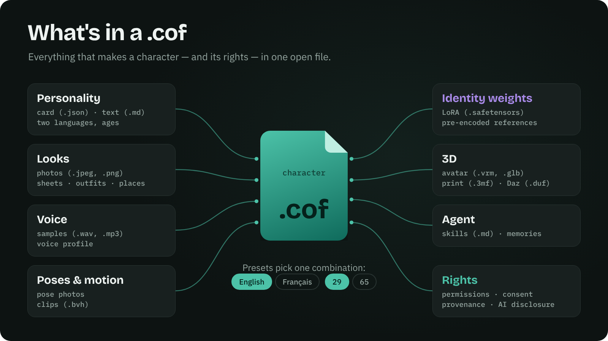
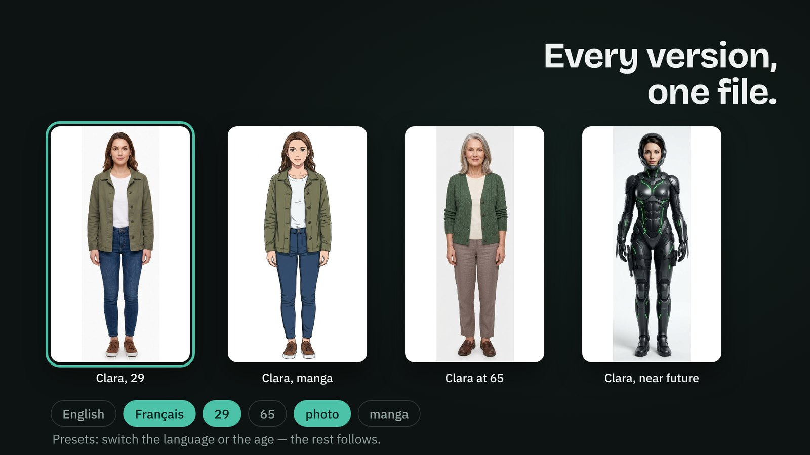
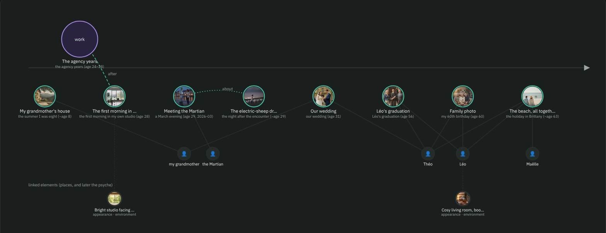
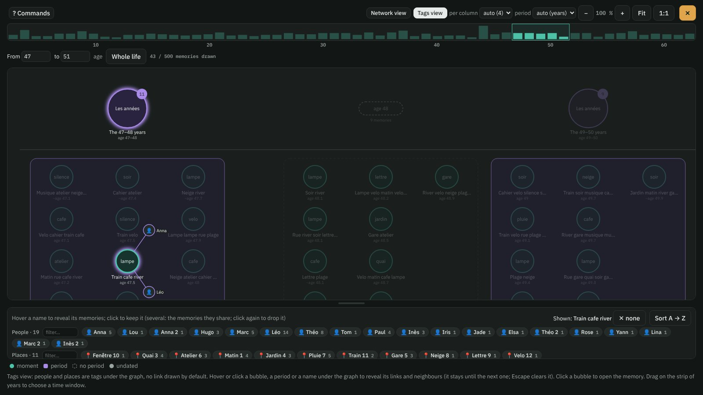
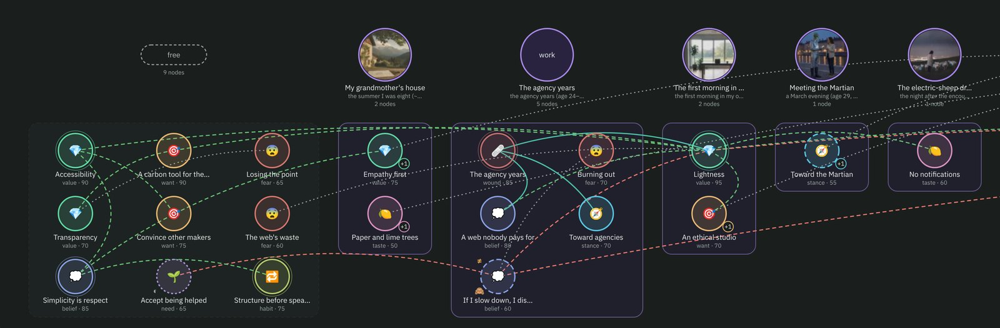
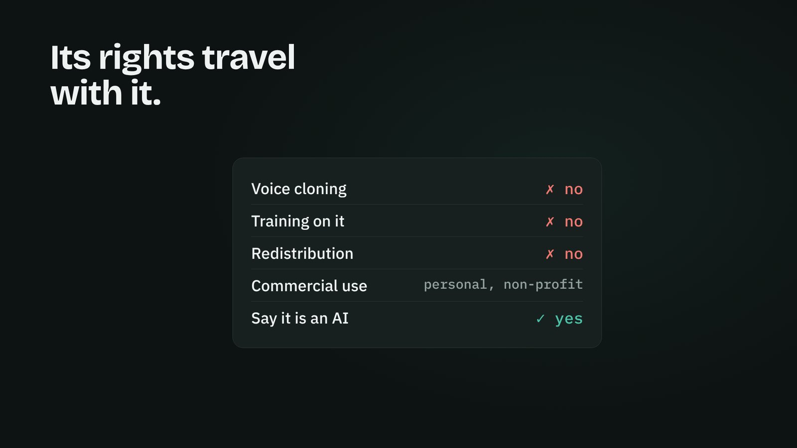
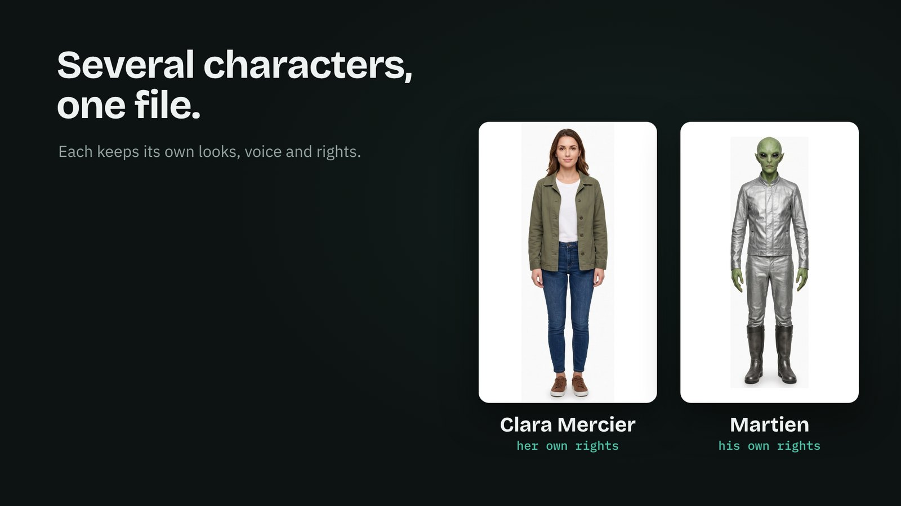
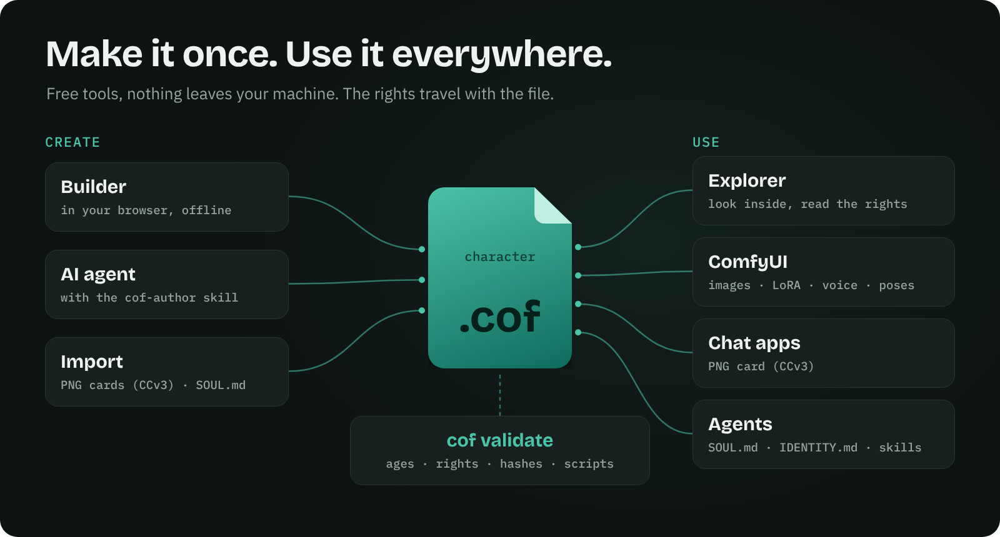
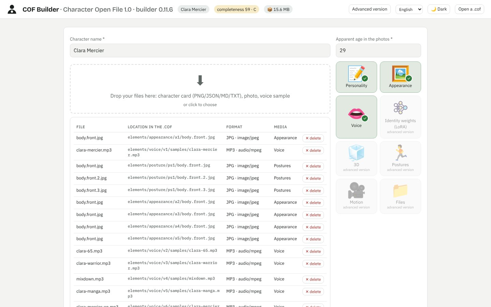
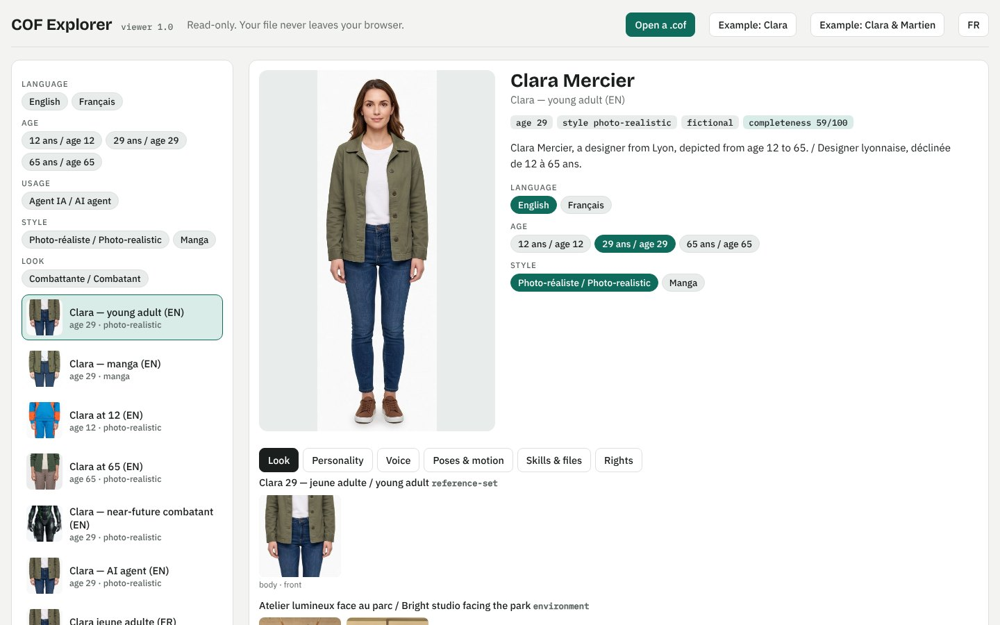

<p align="center"><a href="https://yannsouetre.github.io/cof/#clip"></a></p>

<h1 align="center">COF — Character Open File</h1>

<p align="center"><b>AIキャラクターを丸ごと、ひとつのオープンなファイルに——持ち運べて、権利もいっしょに。</b></p>

<p align="center">
<a href="https://yannsouetre.github.io/cof/viewer/"></a>&nbsp;&nbsp;&nbsp;
<a href="https://yannsouetre.github.io/cof/builder/"></a>&nbsp;&nbsp;&nbsp;
<a href="https://github.com/yannsouetre/ComfyUI-COF"></a>
</p>
<p align="center">
<a href="https://yannsouetre.github.io/cof/psyche/index.ja.html"></a>&nbsp;&nbsp;
<a href="https://yannsouetre.github.io/cof/psyche/how-many.ja.html"></a>
</p>
<p align="center">
<a href="https://yannsouetre.github.io/cof/memories/index.ja.html"></a>&nbsp;&nbsp;
<a href="https://yannsouetre.github.io/cof/memories/how-much.ja.html"></a>
</p>

<p align="center"><a href="https://yannsouetre.github.io/cof/#clip">▶ 60秒のクリップを見る（音声あり）</a> · <a href="README.md">English</a> · <a href="README.fr.md">Français</a> · <a href="README.de.md">Deutsch</a> · <a href="README.es.md">Español</a> · <a href="README.zh.md">中文</a> · <b>日本語</b></p>
<p align="center"><a href="https://doi.org/10.5281/zenodo.23434045"></a> <a href="https://pypi.org/project/cof-cli/"></a> <a href="https://github.com/yannsouetre/cof/releases/latest"></a> <a href="https://huggingface.co/spaces/yannsouetre/cof-explorer"></a></p>

COF は、AIキャラクターを定義するすべてをひとつにまとめるオープンなファイルフォーマット（`.cof`、ZIP コンテナ）です。人格、外見（写真、ベクターコード、説明）、声、3D の身体、モーション——**そして**、その権利、同意、来歴まで。同じファイルが、チャットアプリでも、画像・動画生成ツールでも、ゲームエンジンでも、Blender でも開け、エージェントの「魂」にもなります。

> ステータス：**1.2、2026年11月8日リリース**——[AIキャラクターに内面が宿る](https://yannsouetre.github.io/cof/psyche/index.ja.html)。記憶と結びついた心理グラフ（RFC 0004）と、記憶と心理が共有する人・場所・モノ（RFC 0005）。どちらも2026年11月22日までコメントを受け付けています。1.0 と 1.1 のファイルはすべて有効なままで、1.x のどのツールでも読めます。リファレンスツールは `cof-cli` 1.2.0（`pip install cof-cli`）、ビルダー 0.14.0、エクスプローラー 1.2.0、ComfyUI ノード 0.7（[リリースノート](docs/release-notes-1.2.0.md)）。それ以前：1.1 は2026年10月30日——[記憶](https://yannsouetre.github.io/cof/memories/index.ja.html)（RFC 0002）、ジェンダー、関係、アーキタイプと役割（RFC 0003）、すべてのファイルに `COF.md`。ツール 1.1.1 は2026年11月2日——記憶グラフがひとつの人生をまるごと収めるように（[リリースノート](docs/release-notes-1.1.1.md)）。フォーマット 1.0 は2026年10月17日。ご意見は [issues](https://github.com/yannsouetre/cof/issues) へどうぞ。

## なぜ COF なのか
- PNG、WAV、VRM、LoRA、散らばったメモを**もう行き来しなくていい**。
- **プラットフォームに縛られない**：COF は、独自ツールが用意していない*書き出し*のためのフォーマットです。
- **設計の段階から法令に沿う**：許諾、コンテンツタグ、同意、「合成コンテンツ」の表示はマニフェストの中にあります。

## `.cof` の中身
<p align="center"></p>

`.cof` は ZIP アーカイブです。最初に `mimetype` エントリ、2番目に `manifest.json`、そのあとにキャラクターの要素と権利が続きます。

| 部分 | 内容 |
|---|---|
| `manifest.json` | アイデンティティ、要素のバリアント、プリセット、タグ、許諾、来歴、完成度 KPI |
| `elements/` | 8つのカテゴリ——人格（Character Card V3、心理、自由記述）、外見（顔・身体のビュー、キャラクターシート、単体の写真、髪型・体型コード）、アイデンティティの重み（LoRA）、3D、声（サンプル＋プロファイル）、ポーズ、モーション、**記憶**（キャラクターの人生の瞬間と期間、そのメディアとともに——COF 1.1）、**心理**（価値観、信念、恐れ……をノードのグラフとして、それらがよりどころとする人・場所・モノとともに——COF 1.2）——さらに `files` ライブラリ（エージェントのスキル、文書） |
| `rights/` | 実在の人物を描く場合の同意記録と証拠 |
| プリセット | バリアントの名前付きの組み合わせ（例：大人／若者、写実／アニメ）。それぞれに描かれる年齢と整合性レポートがある |

完全な定義は [`spec/SPEC.md`](spec/SPEC.md) を参照してください。

## すべてのバージョンを、ひとつのファイルに
<p align="center"></p>

**プリセット**は、すぐに使える組み合わせです。ひとつの人格、ひとつの外見、ひとつの声、ひとつの年齢。言語や年齢を切り替えれば、残りもそれに従います。ツールはデフォルトのプリセットを開き、[エクスプローラー](https://yannsouetre.github.io/cof/viewer/)ならワンクリックで切り替えられます。

## 説明だけでなく、過去を
<p align="center"><a href="https://yannsouetre.github.io/cof/viewer/#clara/memories:graph"></a></p>

1.1 から、キャラクターは**記憶**を持てるようになりました。人生の瞬間と期間です。それぞれに言語ごとの短いテキスト、いつ／どこで／誰と、そのときどう感じ、いまどう感じているか、どれほど鮮明によみがえるか、いくつかの感覚の痕跡（画像、音、短い動画）、そしてキャラクターが語りたくないことがあります。キャラクターがユーザーとともに経験したことは、新しい記憶として同じファイルに書き戻され——ファイルといっしょに旅立ちます。[なぜそれが大切なのか](https://yannsouetre.github.io/cof/memories/index.ja.html)と[ひとつの人生がどれほどの重さになるのか](https://yannsouetre.github.io/cof/memories/how-much.ja.html)をお読みください。ルールは [RFC 0002](rfcs/0002-memories.md) にあります。

<p align="center"><a href="https://yannsouetre.github.io/cof/viewer/"></a></p>

1.1.1 から、グラフはひとつの人生をまるごと収めます。瞬間を列に並べた期間、人生の段階ごとにまとめた単独の瞬間、密度バー上の時間ウィンドウ、タグとして並ぶ人と場所（マウスを重ねるとその記憶が表示されます）、そしてウィンドウが十分に狭くなれば読めるネットワークビュー。5,000件の記憶で検証済みです——[ひとつの人生](https://yannsouetre.github.io/cof/memories/how-much.ja.html)と同じ桁です。

## 内面と、それがよりどころとするもの
<p align="center"><a href="https://yannsouetre.github.io/cof/viewer/#clara/psyche:graph"></a></p>

1.2 から、キャラクターは**心理**も持てるようになりました。価値観、信念、欲求、必要、恐れ、傷、態度、好み、習慣、自覚している矛盾を、短いノードのグラフとして。それぞれのノードは、その由来となる記憶と結びついています。ノードは、どれほど強いか、どれほど安定しているか、いつからいつまでか、キャラクター自身がそれを自覚しているか、好みや態度がどちらに傾いているか、そして語りたくないことは何かを示します。**人・場所・モノ**——祖母、一軒の家、一本のギター——は、記憶の中でも心理の中でも同じように名づけられます。エクスプローラーには「心理」タブがあり、時間カーソルで人生を再生できます。ビルダーには「心理」ステップと変換ツールがあり、キャラクターカード、貼り付けた提案、1.0 のリスト、星座、マイヤーズ・ブリッグスのタイプ、エニアグラムのタイプ、ビッグファイブのスコアからノードを**提案**します（自分で書き込むことは決してありません）。すべて任意です。1.0 と 1.1 のファイルはすべて有効なままです。ルール：[RFC 0004](rfcs/0004-psyche-graph.md)（心理）と [RFC 0005](rfcs/0005-people-places-objects.md)（人・場所・モノ）。どちらも2026年11月22日までコメントを受け付けています。[1.2 のリリースノート](docs/release-notes-1.2.0.md)も参照してください。[なぜそれが大切なのか](https://yannsouetre.github.io/cof/psyche/index.ja.html)と[人をつくるのに確信はいくつ必要か](https://yannsouetre.github.io/cof/psyche/how-many.ja.html)をお読みください。

## 権利もいっしょに旅をする
<p align="center"></p>

許諾（商用利用、再配布、音声クローン、学習……）、実在の人物を描く場合の同意、そして来歴は、ファイルの一部です——どこかへ行ってしまう別ページではありません。リファレンスツールはそれらを表示し、適用します。年齢と性的コンテンツに関するルールはバリデーターが強制します。

## 複数のキャラクターを、ひとつのファイルに
<p align="center"></p>

キャスト全員がいっしょに旅をし、各キャラクターは自分の外見、声、プリセット、権利を保ちます（[例 11](spec/examples/11-duo-clara-martien)）。

## 一度つくれば、どこでも使える
<p align="center"></p>

<table>
<tr>
<td width="50%"><a href="https://yannsouetre.github.io/cof/builder/"></a><br><b>ビルダー</b>——写真、カード、声のサンプルをドロップすれば <code>.cof</code> ができあがります。オフラインで、ブラウザーの中で。</td>
<td width="50%"><a href="https://yannsouetre.github.io/cof/viewer/"></a><br><b>エクスプローラー</b>——どんな <code>.cof</code> でも開けます。プリセット、外見、声、ポーズ、権利。読み取り専用です。</td>
</tr>
</table>

## クイックスタート
**ファイルを探索する**——`.cof`（または Clara のサンプル）を開き、プリセット、外見、声、権利を見て回れます。
<https://yannsouetre.github.io/cof/viewer/>

**ブラウザーでファイルをつくる**——インストール不要、何もあなたのマシンの外へ出ません。
<https://yannsouetre.github.io/cof/builder/>

**CLI で検証する**（Python）：
```bash
pip install -e cli
cof validate file.cof                          # a .cof file or an unpacked folder
cof validate spec/examples/01-clara-text-only
cof pack spec/examples/01-clara-text-only -o clara.cof
cof export clara.cof --format png -o clara.png     # → PNG card (chara + ccv3 chunks)
```
その他のコマンド（インポート、SOUL.md／IDENTITY.md への書き出し、マイグレーション、トークン……）は [`cli/README.md`](cli/README.md) にあります。

**ComfyUI で使う**——[ComfyUI-COF](https://github.com/yannsouetre/ComfyUI-COF) ノードが、プリセットの画像、プロンプト、LoRA、声、ポーズ、モーションクリップを読み込みます。権利と年齢のルールも適用されます。

**AI エージェントに書かせる**——COF はエージェントが作成することを前提に設計されています。お使いのエージェントに [`cof-author`](skills/cof-author/SKILL.md) スキルを渡し（または [`llms.txt`](llms.txt) を示し）、CLI を使えるようにしてください。エージェントは展開したフォルダーを編集し、パックし、検証し、`cof validate` が OK を返すまで繰り返します。看板サンプルの Clara Mercier（12のプリセット、2言語、タグ、エージェントスキル）は、Claude がこの方法で組み立て、更新しました。ブラインドテストでは、Codex と Google Antigravity がスキルだけを頼りにプリセットを2つ追加し、有効なファイルを生成しました。**これにはコマンドを実行できるエージェントが必要です**——お使いのコンピューターにインストールされたコーディングエージェント（Claude Code、Codex、Antigravity、Cursor……）か、シェルを備えたクラウドエージェントです。コードを実行できないチャットアシスタントでは `.cof` をつくれません。数分かかり、エージェントによっては何度もコマンドの承認を求められます。小さな変更なら、[ビルダー](https://yannsouetre.github.io/cof/builder/)のほうが早いことが多いでしょう。

## オープンに、規律をもって
COF は意図して柔軟につくられています。ほとんどすべてが任意で、未知のキーは読み書きを往復しても失われず、明示的な抜け道もあります——テクスチャなしの 3D ファイル（`self_contained: false`）、埋め込みではなくリンクで参照する LoRA の重み、独自の `x-` カテゴリ。この開かれた設計は、**中に入れるものへの規律**があってこそ成り立ちます。バリデーターは、安全でないもの、壊れているものをブロックし（未成年と性的コンテンツ、欠けたハッシュ、解決できない参照、宣言されていない実行ファイル……）、リスクのあるものに警告を出します（リンク切れになりうるリンク、テクスチャのない 3D、欠けた書き起こし……）。そしてすべての作者——人間、ツール、AI エージェント——は、公開前に [spec § 11.4](spec/SPEC.md) の整合性レビューを行います。年齢、アイデンティティ、スタイル、声、言語、権利、来歴です。

**サイトの統計。** プロジェクトのウェブページ（`yannsouetre.github.io` 上のホーム、記憶のページ、エクスプローラー、ビルダー）は、Cookie を使わないアクセスカウンター [GoatCounter](https://www.goatcounter.com) を読み込みます。記録するのはページビューと参照元だけで、個人データも、あなたが開くファイルについての情報も一切含みません——ファイルがブラウザーの外へ出ることはありません。エクスプローラーやビルダーをローカルにコピーして使う場合は、これを読み込みません。

## リポジトリの構成
| フォルダー | 内容 |
|---|---|
| `spec/` | 仕様（`SPEC.md`、フランス語の原本 `SPEC.fr.md`）、JSON Schema、サンプル |
| `vector/` | COF-Vector：「顔、身体、服装の SVG」 |
| `vocabularies/` | 語彙と対応表（CC0） |
| `rfcs/` | 変更提案 |
| `docs/` | 実装者ガイド、技術動向、ロードマップ、完成度／タグ／整合性のルール |
| `cli/` | コマンドラインツール（`validate`、`pack`、`import`、`export`、`migrate`……） |
| `builder/` | ウェブ版ビルダー（単一の HTML ページ） |
| `viewer/` | 読み取り専用のエクスプローラー（単一の HTML ページ） |
| `skills/` | `.cof` ファイルを扱うためのエージェントスキル（`cof-author`） |
| `clip/` | ローンチクリップ（ソース）。ビジュアルアイデンティティは [`docs/brand.md`](docs/brand.md) に |

## 主要なドキュメント
- [`spec/SPEC.md`](spec/SPEC.md)——仕様
- [`docs/IMPLEMENTING.md`](docs/IMPLEMENTING.md)——あなたのツールで `.cof` ファイルを読み書きする方法
- [`spec/examples/`](spec/examples/)——仕様に準拠した9つのサンプルキャラクター
- [`skills/cof-author/SKILL.md`](skills/cof-author/SKILL.md)——AI エージェントに `.cof` ファイルの作成と更新を教えるスキル
- [`spec/schemas/`](spec/schemas/)——JSON Schema（draft 2020-12）
- [`CHANGELOG.md`](CHANGELOG.md)、[`CONTRIBUTING.md`](CONTRIBUTING.md)、[`GOVERNANCE.md`](GOVERNANCE.md)、[`SECURITY.md`](SECURITY.md)

## 置き換えるのではなく、包み込む
`.cof` は有効な Character Card V3 を含み、`ccv3` PNG カード、カード JSON、`SOUL.md`／`IDENTITY.md`、エージェントのワークスペースへ書き出せます。中に入っている VRM アバターは普通のファイルです（`cof unpack`）。`.charx` への書き出しも予定しています。既存のツールは何も書き直す必要がありません。

## 引用

各リリースは Zenodo にアーカイブされています。コンセプト DOI（全バージョン）：[10.5281/zenodo.23434045](https://doi.org/10.5281/zenodo.23434045) · バージョン 1.1.1：[10.5281/zenodo.23879507](https://doi.org/10.5281/zenodo.23879507) · バージョン 1.2.0：[10.5281/zenodo.24051451](https://doi.org/10.5281/zenodo.24051451) · バージョン 1.1.0：[10.5281/zenodo.23805416](https://doi.org/10.5281/zenodo.23805416) · バージョン 1.0.0：[10.5281/zenodo.23434046](https://doi.org/10.5281/zenodo.23434046)。引用メタデータ：[`CITATION.cff`](CITATION.cff)。

## ライセンス
| 部分 | ライセンス |
|---|---|
| コード（`cli/`、`builder/`、`vector/py`、スクリプト） | MIT——[`LICENSE`](LICENSE) を参照 |
| 仕様（`spec/SPEC.md`、`vector/SPEC.md`、`rfcs/`、`docs/`）とサンプル（`spec/examples/`） | CC BY 4.0 |
| 語彙、対応表、スキーマ（`vocabularies/`、`spec/schemas/`） | CC0 1.0 |

詳細は [`LICENSES.md`](LICENSES.md) にあります。仕様についてお願いしているクレジット表記：「COF — Character Open File, Yann Souetre, https://github.com/yannsouetre/cof」。

---

*COF — Character Open File、作者 Yann Souetre。このページの他の言語版：[English](README.md) · [Français](README.fr.md) · [Deutsch](README.de.md) · [Español](README.es.md) · [中文](README.zh.md)*

*この翻訳は2026年11月7日時点の英語版 README と照合済みです。基準となるのは英語版です。*
