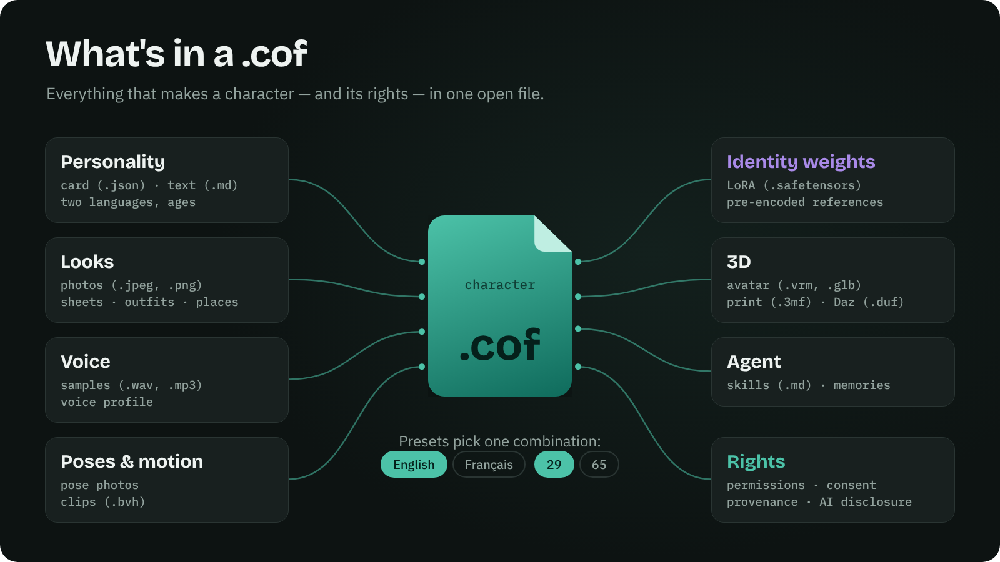
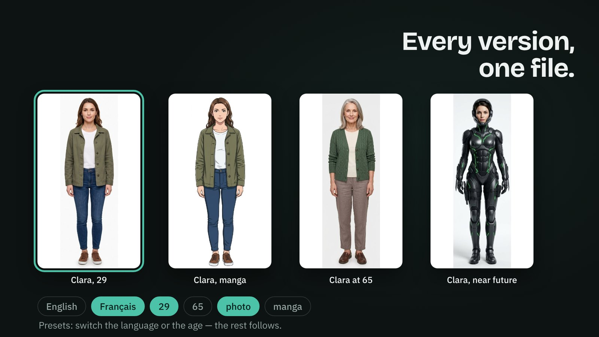
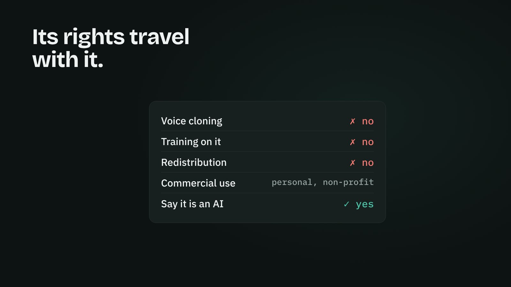
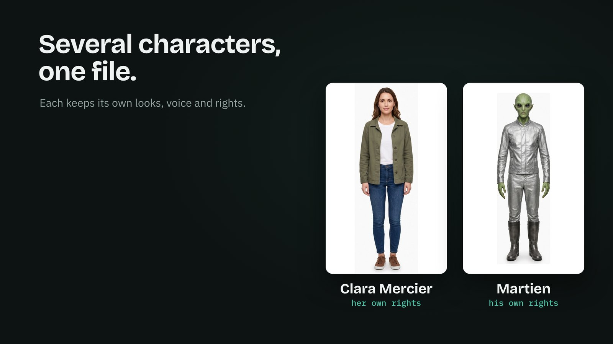
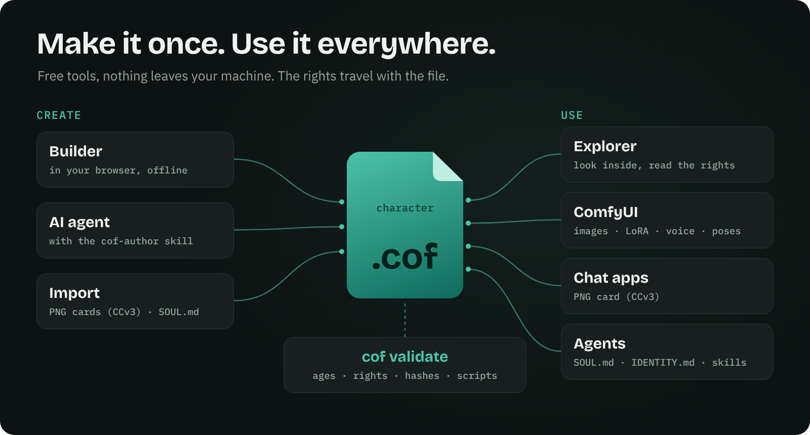
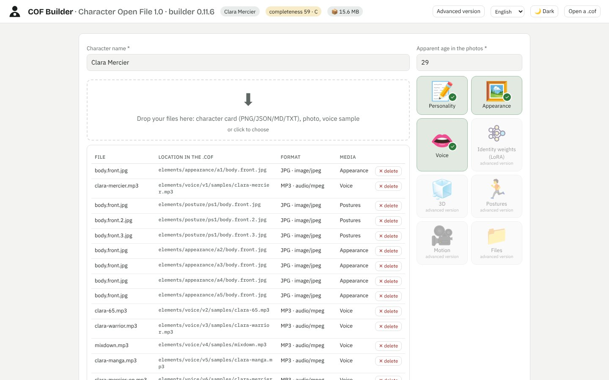
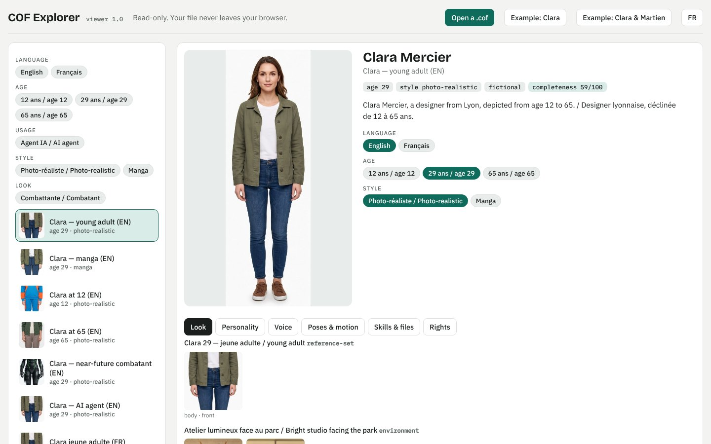

<p align="center"><a href="https://yannsouetre.github.io/cof/#clip"></a></p>

<h1 align="center">COF — Character Open File</h1>

<p align="center"><b>Complete AI characters in one open file — portable, with their rights.</b></p>

<p align="center">
<a href="https://yannsouetre.github.io/cof/viewer/"></a>&nbsp;&nbsp;&nbsp;
<a href="https://yannsouetre.github.io/cof/builder/"></a>&nbsp;&nbsp;&nbsp;
<a href="https://github.com/yannsouetre/ComfyUI-COF"></a>
</p>

<p align="center"><a href="https://yannsouetre.github.io/cof/#clip">▶ Watch the 38-second clip, with sound</a> · <a href="README.fr.md">Français</a></p>

COF is an open file format (`.cof`, a ZIP container) that bundles everything that defines an AI character: personality, appearance (photos, vector code, description), voice, 3D body, motion — **and** its rights, consent and provenance. The same file opens in a chat app, an image or video generator, a game engine, Blender, or serves as the "soul" of an agent.

> Status: **1.0, released on 17 October 2026** — format 1.0 (files written today stay readable by every 1.x tool), reference tooling `cof-cli` 1.0.0 (`pip install cof-cli`), builder 0.11, explorer, ComfyUI nodes. Feedback welcome through the [issues](https://github.com/yannsouetre/cof/issues).

## Why
- **No more juggling** PNGs, WAVs, VRMs, LoRAs and scattered notes.
- **Never locked into a platform**: COF is the *export* format that proprietary tools don't offer.
- **Compliant by construction**: permissions, content tags, consent and "synthetic content" labelling live in the manifest.

## What's in a `.cof`
<p align="center"></p>

A `.cof` is a ZIP archive with a `mimetype` entry first and a `manifest.json` second, followed by the character's elements and rights:

| Part | Content |
|---|---|
| `manifest.json` | Identities, element variants, presets, tags, permissions, provenance, completeness KPI |
| `elements/` | 7 media categories — personality (Character Card V3, psyche, free text), appearance (face/body views, character sheets, loose photos, hair/body codes), identity weights (LoRA), 3D, voice (samples + profile), postures, motion — plus a `files` library (agent skills, memories) |
| `rights/` | Consent record and proofs when a real person is depicted |
| Presets | Named combinations of variants (e.g. adult / young, realistic / anime), each with its own depicted age and coherence report |

See [`spec/SPEC.md`](spec/SPEC.md) for the full definition.

## Every version, one file
<p align="center"></p>

A **preset** is a ready-to-use combination: one personality, one look, one voice, one age. Switch the language or the age, and the rest follows. Tools open the default preset; the [explorer](https://yannsouetre.github.io/cof/viewer/) lets you switch in one click.

## Its rights travel with it
<p align="center"></p>

Permissions (commercial use, redistribution, voice cloning, training…), consent when a real person is depicted, and provenance are part of the file — not a separate page that gets lost. The reference tools show them and apply them; the age and intimate-content rules are enforced by the validator.

## Several characters, one file
<p align="center"></p>

A cast travels together, and each character keeps its own looks, voice, presets and rights ([example 11](spec/examples/11-duo-clara-martien)).

## Make it once, use it everywhere
<p align="center"></p>

<table>
<tr>
<td width="50%"><a href="https://yannsouetre.github.io/cof/builder/"></a><br><b>Builder</b> — drop photos, a card and a voice sample; get a <code>.cof</code>. Offline, in your browser.</td>
<td width="50%"><a href="https://yannsouetre.github.io/cof/viewer/"></a><br><b>Explorer</b> — open any <code>.cof</code>: presets, looks, voices, poses, rights. Read-only.</td>
</tr>
</table>

## Quick start
**Explore a file** — open a `.cof` (or the Clara example) and browse its presets, looks, voices and rights:
<https://yannsouetre.github.io/cof/viewer/>

**Build a file in the browser** — no install, nothing leaves your machine:
<https://yannsouetre.github.io/cof/builder/>

**Validate with the CLI** (Python):
```bash
pip install -e cli
cof validate file.cof                          # a .cof file or an unpacked folder
cof validate spec/examples/01-clara-text-only
cof pack spec/examples/01-clara-text-only -o clara.cof
cof export clara.cof --format png -o clara.png     # → PNG card (chara + ccv3 chunks)
```
More commands (import, export to SOUL.md/IDENTITY.md, migrate, tokens…) in [`cli/README.md`](cli/README.md).

**Use it in ComfyUI** — the [ComfyUI-COF](https://github.com/yannsouetre/ComfyUI-COF) nodes load a preset's images, prompt, LoRA, voice, poses and motion clips, with its rights and age rules enforced.

**Let an AI agent write it** — COF is designed to be authored by agents: give yours the [`cof-author`](skills/cof-author/SKILL.md) skill (or point it to [`llms.txt`](llms.txt)) and the CLI; it edits an unpacked folder, packs, validates and loops until `cof validate` says OK. The flagship example, Clara Mercier (12 presets, two languages, tags, an agent skill), was assembled and updated this way by Claude; in blind tests, Codex and Google Antigravity added two presets with the skill alone and produced a valid file. **This needs an agent that can run commands** — a coding agent installed on your computer (Claude Code, Codex, Antigravity, Cursor…) or a cloud agent with a shell; a chat assistant without code execution cannot build a `.cof`. Expect several minutes and, depending on the agent, many command approvals: for a small change, the [builder](https://yannsouetre.github.io/cof/builder/) is often quicker.

## Open, with discipline
COF is deliberately flexible: almost everything is optional, unknown keys survive round-trips, and there are explicit escape hatches — a 3D file without its textures (`self_contained: false`), LoRA weights by link instead of embedded, custom `x-` categories. That openness only works with **discipline in what goes in**: the validator blocks what is unsafe or broken (minors and intimate content, missing hashes, unresolved references, undeclared executables…), warns about what is risky (links that can rot, untextured 3D, missing transcripts…), and every author — human, tool or AI agent — runs the coherence review of [spec § 11.4](spec/SPEC.md) before publishing: ages, identity, style, voice, language, rights, provenance.

## Repository layout
| Folder | Content |
|---|---|
| `spec/` | The specification (`SPEC.md`, French original `SPEC.fr.md`), JSON Schemas, examples |
| `vector/` | COF-Vector: the "SVG of the face, body and clothing" |
| `vocabularies/` | Vocabularies and mapping tables (CC0) |
| `rfcs/` | Change proposals |
| `docs/` | Implementer guide, state of the art, roadmap, completeness/tags/coherence rules |
| `cli/` | Command-line tool (`validate`, `pack`, `import`, `export`, `migrate`…) |
| `builder/` | The web builder (single HTML page) |
| `viewer/` | The read-only explorer (single HTML page) |
| `skills/` | Agent Skills for working with `.cof` files (`cof-author`) |
| `clip/` | The launch clip (source); visual identity in [`docs/brand.md`](docs/brand.md) |

## Key documents
- [`spec/SPEC.md`](spec/SPEC.md) — the specification
- [`docs/IMPLEMENTING.md`](docs/IMPLEMENTING.md) — how to read and write `.cof` files in your tool
- [`spec/examples/`](spec/examples/) — 9 conformant example characters
- [`skills/cof-author/SKILL.md`](skills/cof-author/SKILL.md) — the skill that teaches an AI agent to create and update `.cof` files
- [`spec/schemas/`](spec/schemas/) — JSON Schemas (draft 2020-12)
- [`CHANGELOG.md`](CHANGELOG.md), [`CONTRIBUTING.md`](CONTRIBUTING.md), [`GOVERNANCE.md`](GOVERNANCE.md), [`SECURITY.md`](SECURITY.md)

## Embrace, don't replace
A `.cof` contains a valid Character Card V3 and exports to a `ccv3` PNG card, a card JSON, `SOUL.md`/`IDENTITY.md` and an agent workspace; a VRM avatar inside is a plain file (`cof unpack`). `.charx` export is planned. Existing tools have nothing to rewrite.

## License
| Part | License |
|---|---|
| Code (`cli/`, `builder/`, `vector/py`, scripts) | MIT — see [`LICENSE`](LICENSE) |
| Specifications (`spec/SPEC.md`, `vector/SPEC.md`, `rfcs/`, `docs/`) and examples (`spec/examples/`) | CC BY 4.0 |
| Vocabularies, mapping tables and schemas (`vocabularies/`, `spec/schemas/`) | CC0 1.0 |

Details in [`LICENSES.md`](LICENSES.md). Requested attribution for the specifications: "COF — Character Open File, Yann Souetre, https://github.com/yannsouetre/cof".

---

*COF — Character Open File, by Yann Souetre. French version of this page: [`README.fr.md`](README.fr.md).*
