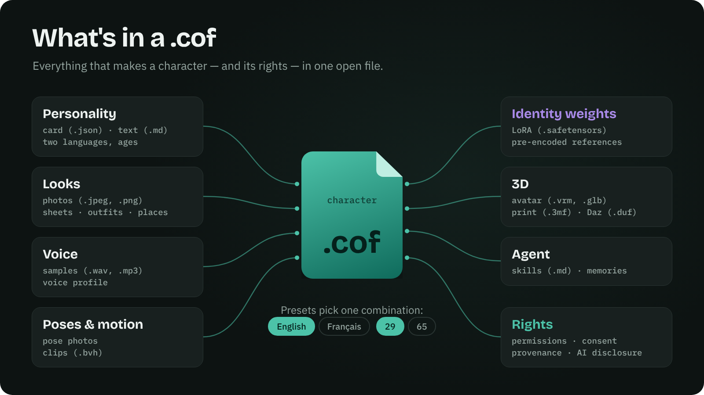
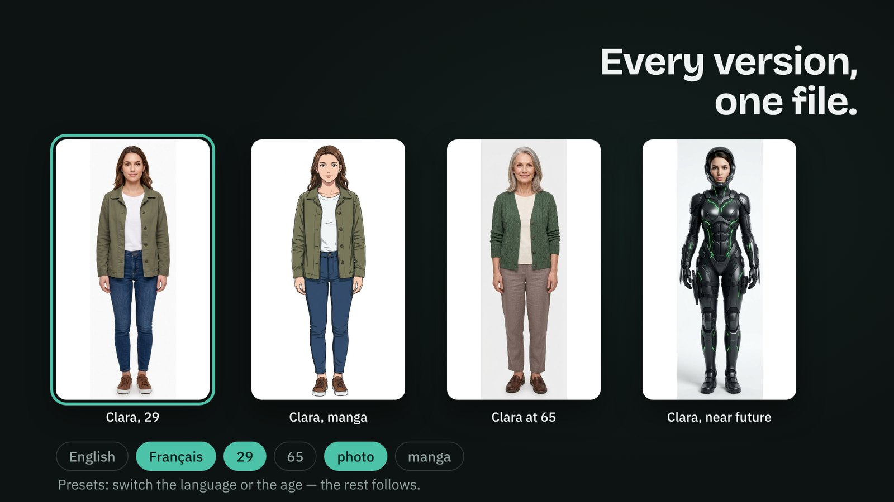
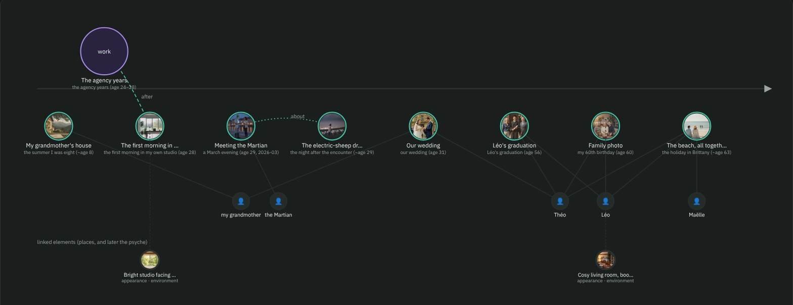
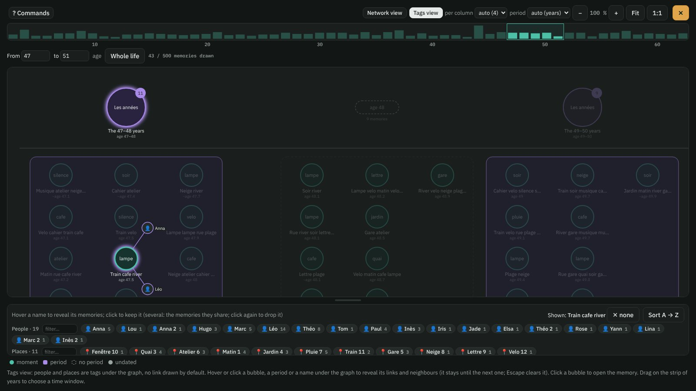
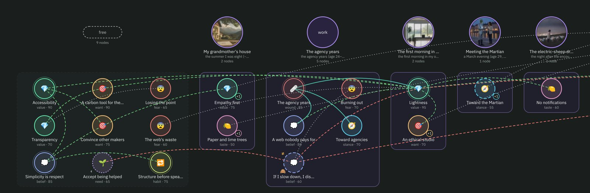
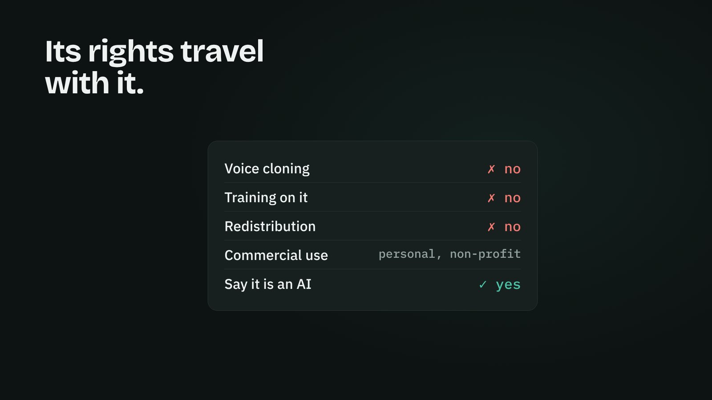
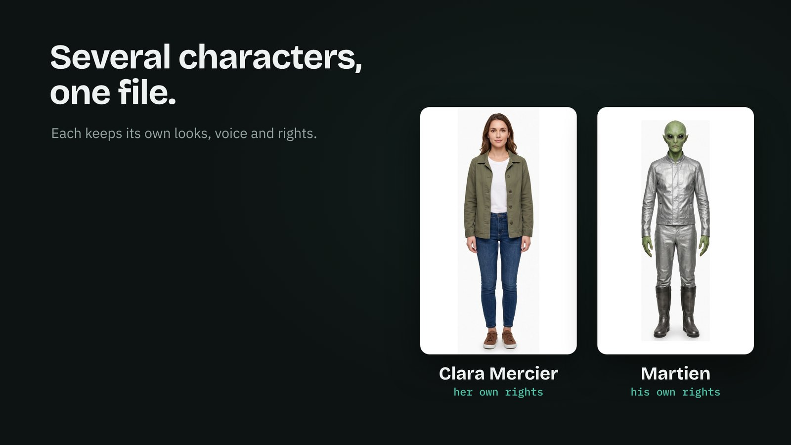
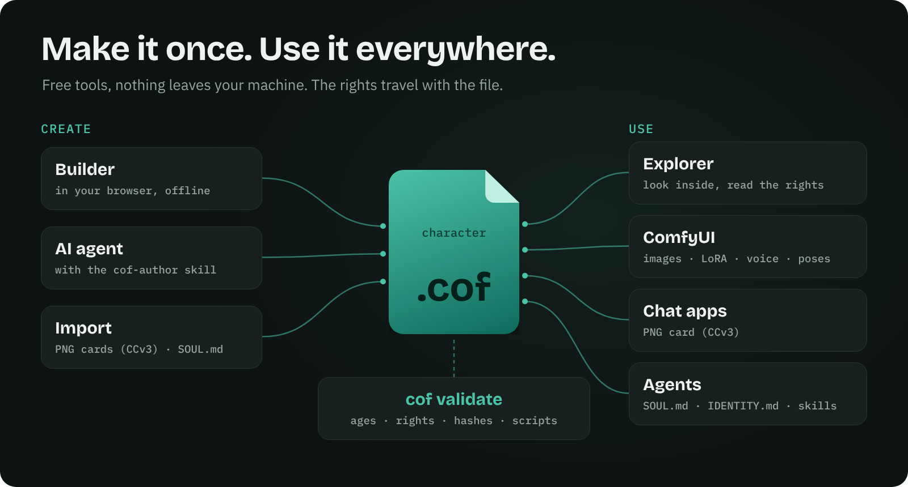
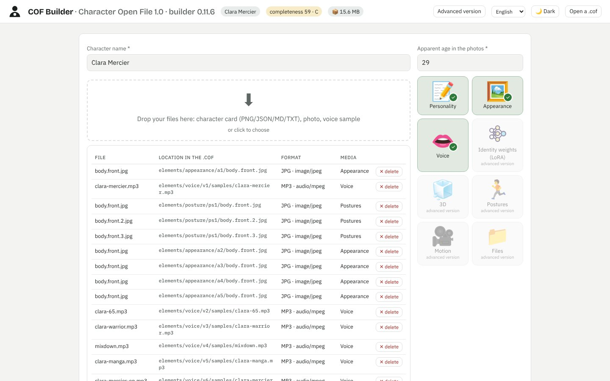
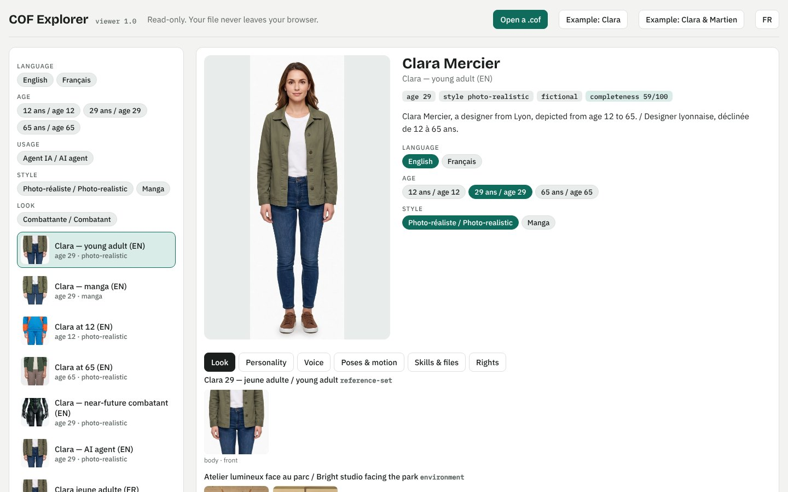

<p align="center"><a href="https://yannsouetre.github.io/cof/#clip"></a></p>

<h1 align="center">COF — Character Open File</h1>

<p align="center"><b>完整的 AI 角色，装进一个开放文件——可携带，并附带其权利。</b></p>

<p align="center">
<a href="https://yannsouetre.github.io/cof/viewer/"></a>&nbsp;&nbsp;&nbsp;
<a href="https://yannsouetre.github.io/cof/builder/"></a>&nbsp;&nbsp;&nbsp;
<a href="https://github.com/yannsouetre/ComfyUI-COF"></a>
</p>
<p align="center">
<a href="https://yannsouetre.github.io/cof/psyche/index.zh.html"></a>&nbsp;&nbsp;
<a href="https://yannsouetre.github.io/cof/psyche/how-many.zh.html"></a>
</p>
<p align="center">
<a href="https://yannsouetre.github.io/cof/memories/index.zh.html"></a>&nbsp;&nbsp;
<a href="https://yannsouetre.github.io/cof/memories/how-much.zh.html"></a>
</p>

<p align="center"><a href="https://yannsouetre.github.io/cof/#clip">▶ 观看 60 秒短片（有声）</a> · <a href="README.md">English</a> · <a href="README.fr.md">Français</a> · <a href="README.de.md">Deutsch</a> · <a href="README.es.md">Español</a> · <b>中文</b> · <a href="README.ja.md">日本語</a></p>
<p align="center"><a href="https://doi.org/10.5281/zenodo.23434045"></a> <a href="https://pypi.org/project/cof-cli/"></a> <a href="https://github.com/yannsouetre/cof/releases/latest"></a> <a href="https://huggingface.co/spaces/yannsouetre/cof-explorer"></a></p>

COF 是一种开放文件格式（`.cof`，一个 ZIP 容器），它把定义一个 AI 角色的一切打包在一起：性格、外貌（照片、矢量代码、描述）、声音、3D 身体、动作——**以及**它的权利、同意与来源。同一个文件可以在聊天应用、图像或视频生成器、游戏引擎、Blender 中打开，也可以充当智能体的“灵魂”。

> 状态：**1.2，发布于 2026 年 11 月 8 日**——[AI 角色如今有了内心世界](https://yannsouetre.github.io/cof/psyche/index.zh.html)：一张与记忆相连的心理图谱（RFC 0004），以及由记忆和心理共享的人物、地点和物品（RFC 0005），两者均开放征求意见至 2026 年 11 月 22 日；所有 1.0 和 1.1 文件依然有效，且可被所有 1.x 工具读取。参考工具：`cof-cli` 1.2.0（`pip install cof-cli`）、builder 0.14.0、浏览器 1.2.0、ComfyUI 节点 0.7（[发布说明](docs/release-notes-1.2.0.md)）。此前：1.1 于 2026 年 10 月 30 日发布——[记忆](https://yannsouetre.github.io/cof/memories/index.zh.html)（RFC 0002）、性别、关系、原型与角色定位（RFC 0003）、每个文件中的 `COF.md`；工具 1.1.1 于 2026 年 11 月 2 日发布——记忆图谱可容纳完整的一生（[发布说明](docs/release-notes-1.1.1.md)）；格式 1.0 于 2026 年 10 月 17 日发布。欢迎通过 [issues](https://github.com/yannsouetre/cof/issues) 提供反馈。

> **从 Character.AI 过来？**[保存您的角色 →](https://yannsouetre.github.io/cof/import/) 拖入您用 CAI Tools 或 PersonaText 导出的文件，核对三项，下载一个 `.cof` 文件：您的角色，以及成为其记忆、保持私密的对话。然后不止于备份：外观、声音、预设、带图片和声音的记忆、以图呈现的心理——在 [builder](https://yannsouetre.github.io/cof/builder/) 中添加，在 [explorer](https://yannsouetre.github.io/cof/viewer/character-ai/) 中浏览。一切都在您的浏览器中完成。COF 1.2.1（2026 年 11 月 8 日）新增 `cof import`、导入页面、builder 0.14.1 和 explorer 1.2.1（[版本说明](docs/release-notes-1.2.1.md)，[RFC 0006](rfcs/0006-platform-import.md)，征求意见至 2026 年 11 月 22 日）。

## 为什么
- **不再东拼西凑**：PNG、WAV、VRM、LoRA 和零散的笔记。
- **永不被平台锁定**：COF 正是专有工具不提供的那种*导出*格式。
- **生来合规**：权限、内容标签、同意以及“合成内容”标注都写在清单（manifest）里。

## `.cof` 里有什么
<p align="center"></p>

`.cof` 是一个 ZIP 压缩包，第一个条目是 `mimetype`，第二个是 `manifest.json`，其后是角色的各项元素及其权利：

| 部分 | 内容 |
|---|---|
| `manifest.json` | 身份、元素变体、预设、标签、权限、来源、完整度 KPI |
| `elements/` | 8 个类别——性格（Character Card V3、心理、自由文本）、外貌（面部/身体视图、角色设定图、零散照片、发型/身体代码）、身份权重（LoRA）、3D、声音（样本 + 声音档案）、姿势、动作、**记忆**（角色一生中的时刻与时期，附带其媒体——COF 1.1）、**心理**（价值观、信念、恐惧……以节点图谱的形式呈现，并附带它们所依附的人物、地点和物品——COF 1.2）——外加一个 `files` 资料库（智能体技能、文档） |
| `rights/` | 描绘真实人物时的同意记录与证明 |
| 预设 | 变体的命名组合（例如成年 / 年轻、写实 / 动漫），各自带有所描绘的年龄和一致性报告 |

完整定义见 [`spec/SPEC.md`](spec/SPEC.md)。

## 所有版本，一个文件
<p align="center"></p>

**预设**是一种即用的组合：一种性格、一种外貌、一种声音、一个年龄。切换语言或年龄，其余部分随之而变。各工具默认打开默认预设；[浏览器](https://yannsouetre.github.io/cof/viewer/)让你一键切换。

## 一段过去，而不只是一段描述
<p align="center"><a href="https://yannsouetre.github.io/cof/viewer/#clara/memories:graph"></a></p>

自 1.1 起，角色可以携带**记忆**：它一生中的时刻与时期，每一条都有各语言的简短文字、何时 / 何地 / 与谁、当时和如今的感受、回想起来有多清晰、几条感官痕迹（图像、声音、一段短视频），以及角色宁愿不说的内容。角色与用户共同经历的事，会作为新的记忆写回同一个文件——并随文件一起带走。阅读[为什么这很重要](https://yannsouetre.github.io/cof/memories/index.zh.html)和[一生能有多重](https://yannsouetre.github.io/cof/memories/how-much.zh.html)；规则见 [RFC 0002](rfcs/0002-memories.md)。

<p align="center"><a href="https://yannsouetre.github.io/cof/viewer/"></a></p>

自 1.1.1 起，图谱可容纳完整的一生：各时期及其时刻分列排布，零散时刻按人生阶段归类，密度条上的时间窗口，人物和地点以标签呈现（悬停其上即可看到相关记忆），当时间窗口小到足以阅读时还有网络视图。已在 5 000 条记忆上测试——这正是[一生](https://yannsouetre.github.io/cof/memories/how-much.zh.html)的数量级。

## 内心世界，以及它所依附的一切
<p align="center"><a href="https://yannsouetre.github.io/cof/viewer/#clara/psyche:graph"></a></p>

自 1.2 起，角色还可以携带**心理**：它的价值观、信念、欲望、需求、恐惧、创伤、立场、喜好、习惯以及自认的矛盾，以简短节点组成的图谱呈现，每个节点都与其来源记忆相连。一个节点会说明它有多强、多稳定、从何时起到何时止、角色自己是否知道、某种喜好或立场偏向哪一边，以及角色宁愿不说的内容。**人物、地点和物品**——一位祖母、一座房子、一把吉他——在记忆和心理中以同样的方式命名。浏览器有一个“心理”标签页，带有时间游标，可以播放角色的一生；builder 有一个“心理”步骤和一个转换器，它可以根据角色卡、粘贴的提议、1.0 列表、星座、Myers-Briggs 类型、九型人格类型或大五人格分数**提议**节点（但绝不会自行写入）。一切皆为可选：所有 1.0 和 1.1 文件依然有效。规则：[RFC 0004](rfcs/0004-psyche-graph.md)（心理）和 [RFC 0005](rfcs/0005-people-places-objects.md)（人物、地点、物品），开放征求意见至 2026 年 11 月 22 日；参见 [1.2 发布说明](docs/release-notes-1.2.0.md)。阅读[为什么这很重要](https://yannsouetre.github.io/cof/psyche/index.zh.html)和[多少条信条才构成一个人](https://yannsouetre.github.io/cof/psyche/how-many.zh.html)。

## 它的权利随它同行
<p align="center"></p>

权限（商业使用、再分发、声音克隆、训练……）、描绘真实人物时的同意以及来源，都是文件的一部分——而不是一张容易遗失的单独页面。参考工具会展示并执行这些权利；年龄与亲密内容规则由验证器强制执行。

## 多个角色，一个文件
<p align="center"></p>

一组角色可以一同流转，每个角色都保留自己的外貌、声音、预设和权利（[示例 11](spec/examples/11-duo-clara-martien)）。

## 一次制作，处处可用
<p align="center"></p>

<table>
<tr>
<td width="50%"><a href="https://yannsouetre.github.io/cof/builder/"></a><br><b>Builder</b>——拖入照片、一张角色卡和一段声音样本，即可得到一个 <code>.cof</code>。离线运行，就在你的网页浏览器中。</td>
<td width="50%"><a href="https://yannsouetre.github.io/cof/viewer/"></a><br><b>浏览器</b>——打开任意 <code>.cof</code>：预设、外貌、声音、姿势、权利。只读。</td>
</tr>
</table>

## 快速上手
**浏览一个文件**——打开一个 `.cof`（或 Clara 示例），浏览它的预设、外貌、声音和权利：
<https://yannsouetre.github.io/cof/viewer/>

**在网页浏览器中创建文件**——无需安装，任何数据都不会离开你的电脑：
<https://yannsouetre.github.io/cof/builder/>

**用命令行工具验证**（Python）：
```bash
pip install -e cli
cof validate file.cof                          # a .cof file or an unpacked folder
cof validate spec/examples/01-clara-text-only
cof pack spec/examples/01-clara-text-only -o clara.cof
cof export clara.cof --format png -o clara.png     # → PNG card (chara + ccv3 chunks)
```
更多命令（导入、导出为 SOUL.md/IDENTITY.md、迁移、token 统计……）见 [`cli/README.md`](cli/README.md)。

**在 ComfyUI 中使用**——[ComfyUI-COF](https://github.com/yannsouetre/ComfyUI-COF) 节点可载入某个预设的图像、提示词、LoRA、声音、姿势和动作片段，并强制执行其权利与年龄规则。

**让 AI 智能体来编写**——COF 的设计初衷之一就是由智能体编写：给你的智能体配上 [`cof-author`](skills/cof-author/SKILL.md) 技能（或让它读取 [`llms.txt`](llms.txt)）以及命令行工具；它会编辑解包后的文件夹、打包、验证，并反复循环直到 `cof validate` 显示 OK。旗舰示例 Clara Mercier（12 个预设、两种语言、标签、一项智能体技能）就是由 Claude 以这种方式组装和更新的；在盲测中，Codex 和 Google Antigravity 仅凭该技能就添加了两个预设，并生成了有效文件。**这需要一个能运行命令的智能体**——安装在你电脑上的编程智能体（Claude Code、Codex、Antigravity、Cursor……）或带有 shell 的云端智能体；没有代码执行能力的聊天助手无法构建 `.cof`。预计需要几分钟，并且视智能体而定，可能需要多次批准命令：对于小改动，[builder](https://yannsouetre.github.io/cof/builder/) 往往更快。

## 开放，但有纪律
COF 有意保持灵活：几乎一切都是可选的，未知的键在往返转换中得以保留，还有明确的“逃生通道”——不含贴图的 3D 文件（`self_contained: false`）、以链接代替嵌入的 LoRA 权重、自定义的 `x-` 类别。这种开放只有在**对放入内容保持纪律**时才能奏效：验证器会拦截不安全或已损坏的内容（未成年人与亲密内容、缺失的哈希值、无法解析的引用、未声明的可执行文件……），对有风险的内容发出警告（可能失效的链接、无贴图的 3D、缺失的文字稿……），并且每位作者——无论是人、工具还是 AI 智能体——在发布前都要执行 [spec § 11.4](spec/SPEC.md) 中的一致性审查：年龄、身份、风格、声音、语言、权利、来源。

**网站统计。** 本项目的网页（`yannsouetre.github.io` 上的首页、记忆页面、浏览器、builder）会加载一个不使用 cookie 的访问计数器 [GoatCounter](https://www.goatcounter.com)：仅统计页面浏览量和来源，不收集个人数据，也不涉及你打开的文件——这些文件从不离开你的网页浏览器。浏览器或 builder 的本地副本从不加载它。

## 仓库结构
| 文件夹 | 内容 |
|---|---|
| `spec/` | 规范（`SPEC.md`，法语原版 `SPEC.fr.md`）、JSON Schema、示例 |
| `vector/` | COF-Vector：“面部、身体和服装的 SVG” |
| `vocabularies/` | 词表与映射表（CC0） |
| `rfcs/` | 变更提案 |
| `docs/` | 实现者指南、技术现状、路线图、完整度/标签/一致性规则 |
| `cli/` | 命令行工具（`validate`、`pack`、`import`、`export`、`migrate`……） |
| `builder/` | 网页版 builder（单个 HTML 页面） |
| `viewer/` | 只读浏览器（单个 HTML 页面） |
| `skills/` | 用于处理 `.cof` 文件的智能体技能（`cof-author`） |
| `clip/` | 发布短片（源文件）；视觉识别见 [`docs/brand.md`](docs/brand.md) |

## 重要文档
- [`spec/SPEC.md`](spec/SPEC.md)——规范
- [`docs/IMPLEMENTING.md`](docs/IMPLEMENTING.md)——如何在你的工具中读写 `.cof` 文件
- [`spec/examples/`](spec/examples/)——9 个符合规范的示例角色
- [`skills/cof-author/SKILL.md`](skills/cof-author/SKILL.md)——教 AI 智能体创建和更新 `.cof` 文件的技能
- [`spec/schemas/`](spec/schemas/)——JSON Schema（draft 2020-12）
- [`CHANGELOG.md`](CHANGELOG.md)、[`CONTRIBUTING.md`](CONTRIBUTING.md)、[`GOVERNANCE.md`](GOVERNANCE.md)、[`SECURITY.md`](SECURITY.md)

## 兼容并包，而非取而代之
一个 `.cof` 包含一张有效的 Character Card V3，并可导出为 `ccv3` PNG 卡片、卡片 JSON、`SOUL.md`/`IDENTITY.md` 以及智能体工作区；其中的 VRM 虚拟形象就是一个普通文件（`cof unpack`）。`.charx` 导出已在计划中。现有工具无需任何重写。

## 引用

每个版本都存档于 Zenodo。概念 DOI（所有版本）：[10.5281/zenodo.23434045](https://doi.org/10.5281/zenodo.23434045) · 1.1.1 版：[10.5281/zenodo.23879507](https://doi.org/10.5281/zenodo.23879507) · 1.2.1 版：[10.5281/zenodo.24055335](https://doi.org/10.5281/zenodo.24055335) · 1.2.0 版：[10.5281/zenodo.24051451](https://doi.org/10.5281/zenodo.24051451) · 1.1.0 版：[10.5281/zenodo.23805416](https://doi.org/10.5281/zenodo.23805416) · 1.0.0 版：[10.5281/zenodo.23434046](https://doi.org/10.5281/zenodo.23434046)。引用元数据：[`CITATION.cff`](CITATION.cff)。

## 许可证
| 部分 | 许可证 |
|---|---|
| 代码（`cli/`、`builder/`、`vector/py`、脚本） | MIT——见 [`LICENSE`](LICENSE) |
| 规范（`spec/SPEC.md`、`vector/SPEC.md`、`rfcs/`、`docs/`）和示例（`spec/examples/`） | CC BY 4.0 |
| 词表、映射表和 Schema（`vocabularies/`、`spec/schemas/`） | CC0 1.0 |

详情见 [`LICENSES.md`](LICENSES.md)。规范的署名要求：“COF — Character Open File, Yann Souetre, https://github.com/yannsouetre/cof”。

---

*COF — Character Open File，作者 Yann Souetre。本页的其他语言版本：[English](README.md) · [Français](README.fr.md) · [Deutsch](README.de.md) · [Español](README.es.md) · [日本語](README.ja.md)。*

*译文已对照 2026 年 11 月 7 日的英文 README 核对；以英文版为准。*
